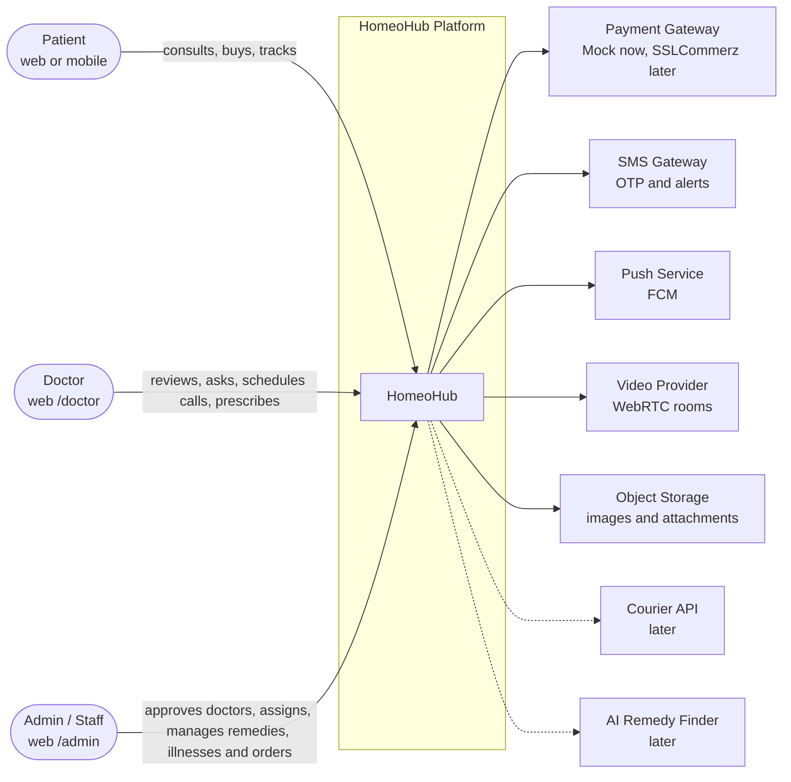
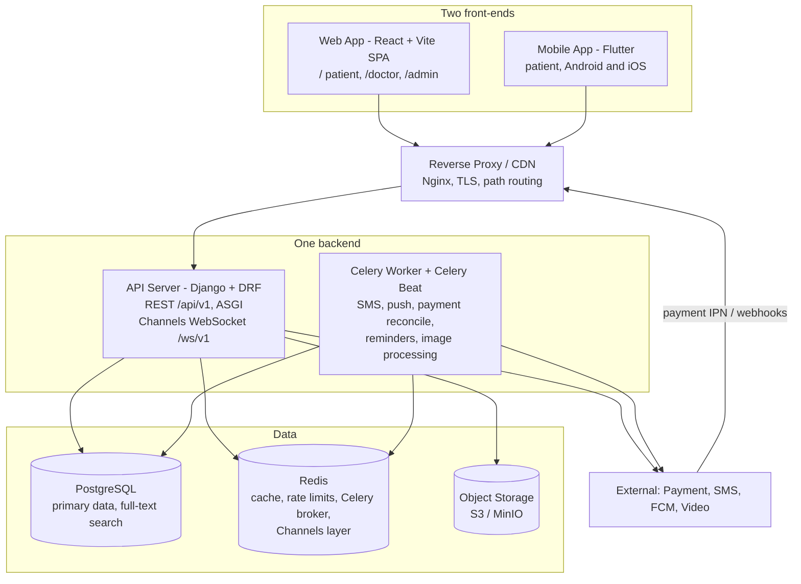
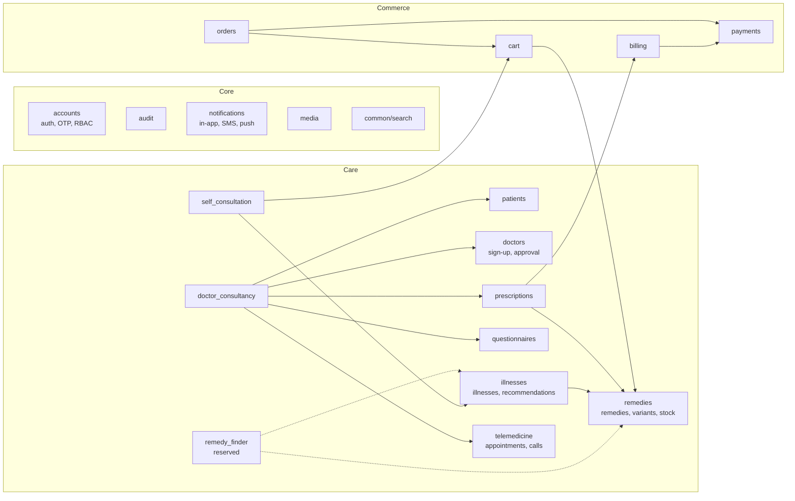
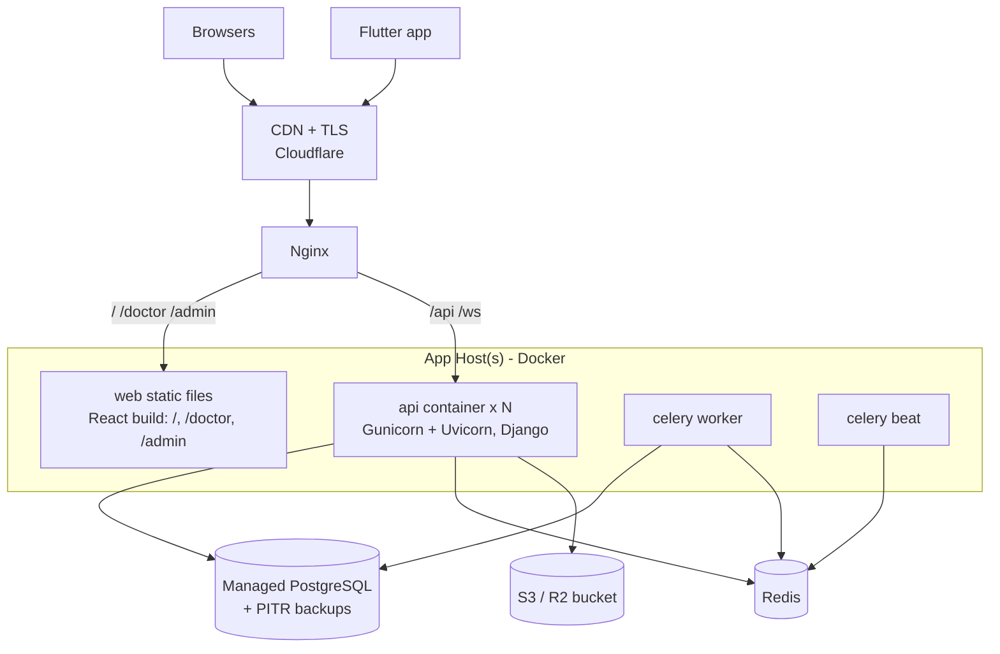

# HomeoHub — Architectural Design

> Natural · Holistic · Healing
> Version 0.2 · 2026-11-11 · Status: Draft for review
> Changes from 0.1: doctor area moved to `/doctor`; product decisions recorded (§13); backend changed to Django + DRF (ADR-09); Flutter mobile app added (see [03-mobile-app.md](03-mobile-app.md)).

---

## 1. Purpose & Scope

HomeoHub is a homeopathy care platform with two care paths for patients:

| Path | What happens | When the patient pays |
|---|---|---|
| **Self-consultancy** | Patient picks an illness → sees remedies ranked by fit, each with a short differentiating note → adds to cart → checks out → tracks delivery | At checkout (online or cash on delivery) |
| **Doctor-consultancy** | Patient describes primary / secondary / tertiary concerns → admin assigns a doctor → doctor asks follow-up questions, may schedule a video call → issues prescription | Online, to **view** the prescription (doctor fee + platform fee). Buying the prescribed remedies goes through the normal cart → checkout flow |

**One backend, two front-ends:**

- **Web app** — one React app with three areas: patient (`homeohub.com/`), doctor (`homeohub.com/doctor`), admin (`homeohub.com/admin`).
- **Mobile app** — Flutter (Android first, then iOS). Patient features in v1; doctor features later.

**In scope (v1):** patient web + mobile, doctor area, admin panel with RBAC, remedies, illness library, cart/checkout/orders with cash on delivery, mock payment gateway, scheduled video doctor consultations, keyword search on every list, Bangla + English UI.

**Out of scope (v1):** AI Remedy Finder (architecture reserves a slot for it), live SSLCommerz (a mock adapter with the same contract is used), courier API integration (admin updates delivery status by hand), doctor features in the mobile app.

---

## 2. Actors

| Actor | Where they work | Sign-in |
|---|---|---|
| **Guest** | Web / mobile | — (can browse illnesses and remedies) |
| **Patient** | Web (`/`) and mobile app | Phone + password |
| **Doctor** | Web (`/doctor`) | Mobile number + password. Doctors sign up themselves; they can only use the doctor area **after an admin approves them**, at which point the doctor ID is issued |
| **Staff** (admin, case manager, remedy manager, illness manager, fulfilment, finance, support) | Web (`/admin`) | Mobile number + password |
| **Payment gateway** (Mock → SSLCommerz) | External | Server-to-server |
| **SMS gateway** | External | Server-to-server |
| **Push service** (Firebase Cloud Messaging) | External | Server-to-server |
| **Video provider** | External | Server-issued room tokens |

Each account belongs to exactly one person. There are no family or dependent profiles — a family member who needs care makes their own account.

---

## 3. Architecture Style

**Modular monolith** — one backend deployable, split into strongly bounded Django apps that talk to each other only through each app's service layer and domain signals.

Why this and not microservices:

- One small team, one database, one deploy pipeline — far less operational cost at launch.
- App boundaries are enforced by convention and review (no cross-app model writes, no importing another app's internals), so any part (e.g. Payments, Telemedicine, AI Finder) can be pulled out into its own service later.
- Transactions that span modules (e.g. "payment succeeded → unlock prescription → notify patient") stay simple and consistent.

External services (payment, SMS, push, video, storage, courier, AI) sit behind **adapter interfaces** (ports & adapters), so the mock payment gateway can be swapped for SSLCommerz by changing configuration, not code.

Both front-ends use the **same versioned REST API** (`/api/v1/`, WebSocket `/ws/v1/`; versioning rules in system design §6.2). The API contract is published as OpenAPI and typed clients are generated for TypeScript (web) and Dart (mobile), so the two front-ends cannot drift from the backend.

---

## 4. System Context (C4 Level 1)



---

## 5. Containers (C4 Level 2)



| Container | Responsibility |
|---|---|
| **Web App** | One React SPA, three areas loaded on demand (route-level code splitting, so patients never download doctor/admin code). **Patient** `/`: sign-in/up, profile, illness library, remedies, cart/checkout, consult-a-doctor, answers, appointments, video, prescriptions, orders. **Doctor** `/doctor`: sign-up/approval status, queue, patient history, questionnaires, appointment scheduling, video, prescriptions. **Admin** `/admin`: doctor approvals, assignment queue, users, remedies, illnesses, orders, payments, roles, settings, audit log. |
| **Mobile App** | Flutter patient app with the same features as the web patient area, plus push notifications, deep links and native video. See [03-mobile-app.md](03-mobile-app.md). |
| **API Server** | All business rules, authN/authZ, REST API, WebSocket gateway (Django Channels) for live notifications and call ringing. Stateless → scale horizontally. Runs under Gunicorn with Uvicorn workers (ASGI). |
| **Celery Worker + Beat** | Same codebase, different process. Runs queued and scheduled jobs so user requests stay fast. |
| **PostgreSQL** | System of record. Also handles keyword search (`SearchVector` + `pg_trgm`) so v1 needs no separate search engine. |
| **Redis** | Cache, refresh-token blacklist, OTP and rate-limit counters, Celery broker, Channels layer for multi-instance fan-out. |
| **Object Storage** | Profile pictures, remedy images, doctor certificates, patient attachments. Private bucket + short-lived signed URLs. |

---

## 6. Backend Modules (C4 Level 3)

Each module is a Django app under `backend/apps/`.



| Module | Owns | Key responsibilities |
|---|---|---|
| **accounts** | users, credentials, groups/roles, permissions, OTPs, refresh tokens, device tokens | Sign-up/in for 3 login types, OTP verification, password reset, JWT issue/rotate, RBAC, push device registration |
| **patients** | patient profile, addresses, family history, mental/general picture, likes/dislikes, medical history | Profile CRUD, completeness score, read-only "case summary" for the assigned doctor |
| **doctors** | doctor profile, credentials/certificates, approval status | Doctor self sign-up, admin approval/rejection, doctor ID issue, fee, availability flag |
| **remedies** | remedies, remedy variants (potency × form × pack × price × stock), remedy images | Remedy CRUD (admin), public remedy list/detail, variant availability; the remedy source for cart, orders, prescriptions and illnesses |
| **illnesses** | illness categories, illnesses, illness→remedy recommendations | Illness library CRUD (admin), public illness list/detail, ranked recommendations per illness; reads remedy data only through the remedies module |
| **self_consultation** | self-consultation sessions | Records illness → remedy → cart path for patient history and future AI ranking |
| **doctor_consultancy** | doctor consultations, concerns, assignment, status history, doctor notes | Patient submits/withdraws; admin assigns; doctor works the case; lifecycle state machine |
| **questionnaires** | question templates, sent question sets, answers | Template library tagged by concern category; doctor sends a set; patient answers |
| **prescriptions** | prescriptions, items, advice (do's/don'ts), report-after date | Doctor issues; content locked until consultation fee paid; "add prescribed remedies to cart" |
| **telemedicine** | video appointments, appointment events, call sessions | Doctor proposes time → patient accepts / rejects / asks to reschedule → doctor starts the call at the time; room tokens from the video provider |
| **cart** | cart, cart items | One active cart per patient; items reference a remedy variant; source tag (self-consult / prescription / finder) |
| **orders** | orders, order items (price snapshot), shipping address snapshot, status history, stock movements | Checkout (online or COD), stock reservation, fulfilment status, delivery tracking |
| **billing** | consultation invoices (doctor fee + platform fee snapshot) | Raised when a prescription is issued; paid → prescription unlocked |
| **payments** | payment transactions, gateway events | Gateway-agnostic: initiate, handle redirect, verify IPN, reconcile, refund; COD collection records |
| **notifications** | notifications, templates, delivery log | In-app (WebSocket + inbox), SMS, push (FCM) |
| **media** | file objects | Upload via signed URL, validation, thumbnails |
| **common/search** | — | Shared `?q=` keyword search + pagination/sort for every list endpoint |
| **audit** | audit events | Who viewed/changed what — required for patient-record access and admin actions |
| **remedy_finder** | reserved | Interface + feature flag only in v1 |

**Module rules** (enforced by code review and an import-linter check in CI):

1. An app writes only its own models. Reading another app's data goes through that app's `services.py` / `selectors.py`.
2. Views stay thin: validation in serializers, business logic in services, queries in selectors.
3. Cross-module side effects use domain events (`payment_succeeded`, `prescription_issued`, `order_shipped`, …) dispatched after the database transaction commits (`transaction.on_commit`); anything slow or external goes to Celery.

---

## 7. Technology Stack

| Layer | Choice | Why |
|---|---|---|
| Backend | **Python 3.12, Django 5.2 LTS + Django REST Framework** | Team already ships doctors-hub on it; built-in auth, groups/permissions (RBAC), migrations, admin tooling; reuse of proven code |
| API docs / contract | **drf-spectacular** (OpenAPI 3) → generated TypeScript client (web) and Dart client (mobile) | One contract, two typed front-ends |
| Auth | **djangorestframework-simplejwt** (rotation + blacklist), Argon2 password hasher | Same as doctors-hub, plus stronger hashing |
| Filtering / search | **django-filter** + `django.contrib.postgres` (`SearchVector`, `TrigramSimilarity`) | Keyword search on every list without a separate engine |
| Background jobs | **Celery 5 + Celery Beat**, Redis broker | Retries, scheduled reminders, reconciliation |
| Realtime | **Django Channels** + `channels-redis` | Notifications, appointment and call events |
| Database | **PostgreSQL 16** | Relational integrity for orders/payments; JSONB for flexible profile and answer data; full-text and trigram search |
| Object storage | **django-storages** → S3-compatible (MinIO in dev; S3 or Cloudflare R2 in prod) | Cheap, CDN-friendly, signed URLs |
| Web front-end | **React 19 + Vite + TypeScript**, React Router, Tailwind CSS, TanStack Query, React Hook Form + Zod, `react-i18next` | Same base as doctors-hub; TypeScript added for the generated API client |
| Mobile | **Flutter** (Riverpod, go_router, dio, intl ARB bn/en, `livekit_client`, `firebase_messaging`) | Same base as the doctors-hub app; one codebase for Android and iOS |
| Video | **LiveKit** (Cloud to start, self-hostable later) behind a `VideoProvider` adapter | Open-source WebRTC, SDKs for React and Flutter, server-issued tokens |
| Payment | `PaymentGateway` interface → **MockGateway** (dev) → **SSLCommerzGateway** (later) | Same contract as SSLCommerz: init session → hosted page → redirect + IPN → validate |
| SMS | `SmsProvider` interface → console (dev) → Bangladeshi SMS provider (prod) | OTP and key alerts |
| Push | `PushProvider` interface → **Firebase Cloud Messaging** | Mobile and web push |
| Testing | pytest + pytest-django + factory-boy (backend), Vitest + Playwright (web), flutter_test + integration_test (mobile) | |
| Observability | Structured JSON logging, Sentry (all three codebases), Prometheus metrics via `django-prometheus` | |
| Delivery | Docker, Docker Compose (dev), GitHub Actions CI/CD | |

---

## 8. Cross-Cutting Concerns

### 8.1 Authentication

| User type | Identifier | Factors | Notes |
|---|---|---|---|
| Patient | Phone number (E.164, `+8801XXXXXXXXX`) | Password; OTP at sign-up and password reset | Phone must be verified before checkout or consulting |
| Doctor | Mobile number | Password | Signs up with phone + password + credentials; can sign in only after approval; doctor ID sent by SMS on approval |
| Staff | Mobile number | Password | Created by Super Admin |

- Access token: JWT, 15 min, carries `user_id`, `user_type`, `perm_version`.
- Refresh token: 30 days (patients) / 12 h (doctor, staff), rotated on every use, old ones blacklisted.
  - **Web** keeps the refresh token in an httpOnly, Secure, SameSite cookie.
  - **Mobile** receives it in the response body and keeps it in the OS keystore (`flutter_secure_storage`).
- Rate limits: sign-in 5/min per identifier + per IP; OTP 3 sends per 15 min.

### 8.2 Authorization (RBAC + ownership)

Two layers, both enforced in the API (never only in the UI):

1. **Permission check (RBAC)** — built on Django Groups and Permissions. Each view declares the permission it needs (custom DRF permission class `HasPerm("doctor_consultancy.assign_doctor_consultation")`). Roles = Groups, editable by the Super Admin from `/admin`.
2. **Ownership / relationship check** — a patient sees only their own data; a doctor sees a patient's profile and history **only while assigned to an active or past consultation with that patient**; a doctor whose status is not `APPROVED` gets nothing but their own application.

Default roles:

| Role | Typical permissions |
|---|---|
| `PATIENT` | own profile, own doctor consultations, appointments, cart, orders, pay |
| `DOCTOR` | read assigned doctor consultations and patients, send questionnaires, schedule calls, write prescriptions |
| `SUPER_ADMIN` | everything, incl. role and staff management |
| `ADMIN` | everything except role management |
| `DOCTOR_MANAGER` | review doctor applications, approve / reject / suspend doctors, set doctor fees |
| `CASE_MANAGER` | read all doctor consultations, assign / reassign doctors |
| `REMEDY_MANAGER` | remedies, variants, prices, images |
| `ILLNESS_MANAGER` | illness categories, illnesses, ranked recommendations, question templates |
| `FULFILMENT_MANAGER` | orders, order status, COD collection, stock |
| `FINANCE` | payments, invoices, refunds, finance reports |
| `SUPPORT` | read-only on users, orders, doctor consultations (no clinical notes) |

Django's built-in admin site is kept for developers only, at a non-public path (`/django-admin/`, superuser + VPN/IP allow-list), so it never clashes with the product's `/admin`.

### 8.3 Security & Privacy of Health Data

- TLS everywhere; HSTS; secure cookies; CSRF protection on cookie-authenticated web endpoints.
- Database and storage encrypted at rest; daily backups + point-in-time recovery.
- Clinical free text (mental picture, family history, concerns, answers, doctor notes, prescription content) is classed **sensitive**: never logged, hidden from the support role, every read by a doctor or staff member written to the audit log.
- Prescriptions are hidden **server-side** until the consultation invoice is paid — the API returns only a locked summary (doctor name, date, number of remedies, fee).
- Doctor certificates and patient attachments: private bucket, MIME/size checks, signed URLs that expire in minutes.
- Video calls are not recorded.
- Mobile: tokens in the OS keystore; prescription screen blocks screenshots on Android.
- OWASP ASVS L2 as the target checklist; `pip-audit`, `npm audit` and Dependabot in CI.

### 8.4 Keyword Search (every list)

One convention for all list endpoints: `GET /api/v1/<resource>/?q=&page=&page_size=&ordering=&<filters>`.

- A shared `KeywordSearchFilter` (DRF filter backend) uses each view's `search_fields`, combining PostgreSQL full-text search with trigram similarity — typo-tolerant and good at partial Latin names such as *Arsenicum album*, and works on Bangla text.
- Shared searchable list components: `<SearchableTable>` on web, `SearchableListView` widget on mobile.
- If search outgrows Postgres, swap the filter backend for Meilisearch without changing the API.

### 8.5 Payments

- A single `PaymentGateway` interface: `initiate()`, `handle_redirect()`, `handle_ipn()`, `validate()`, `refund()`.
- Payment is **never** marked successful from the browser redirect alone — only after server-side validation (IPN or validation API), matching how SSLCommerz works.
- Every payment has a unique `tran_id`; handlers are idempotent.
- Amounts are always computed on the server; prices and fees are snapshotted.
- A reconciliation job re-checks payments stuck in `PENDING` for more than 30 min.
- Payable things:
  - **Order** (remedies) — online **or cash on delivery**.
  - **Consultation invoice** (doctor fee + platform fee) — online only.
- COD: the order is confirmed without payment; fulfilment records the cash collected on delivery, which creates a `COD` payment record so finance reports stay complete.

### 8.6 Notifications

Channels: in-app (WebSocket + inbox), SMS, push (mobile). Each event uses a channel set:

| Event | Patient | Doctor | Staff |
|---|---|---|---|
| Doctor application submitted | — | in-app (status page) | in-app (approvals queue) |
| Doctor approved / rejected | — | SMS (with doctor ID) | — |
| Doctor consultation submitted | in-app | — | in-app (assignment queue) |
| Doctor assigned | in-app + push + SMS | in-app | — |
| Questions sent | in-app + push + SMS | — | — |
| Patient answered | — | in-app | — |
| Video call proposed / rescheduled | in-app + push + SMS | — | — |
| Patient accepted / rejected / asked to reschedule | — | in-app | — |
| Call reminder (30 min and 5 min before) | push + SMS | in-app | — |
| Doctor starts call | in-app ring + high-priority push | — | — |
| Prescription ready (pay to view) | in-app + push + SMS | — | — |
| Payment success / failure | in-app + push | — | — |
| Order status change | in-app + push; SMS on shipped / delivered | — | — |
| Follow-up "report after" due | in-app + push + SMS | in-app | — |

### 8.7 Internationalisation (Bangla + English at launch)

- UI: `react-i18next` (web) and Flutter `intl` ARB files `app_bn.arb` / `app_en.arb` (mobile), same as doctors-hub. Language switch in header/settings, remembered per user.
- Content: remedies, illnesses, recommendation notes, question templates, notification templates and do's/don'ts have `_en` and `_bn` fields. Admins edit both; if `_bn` is empty the English text is shown.
- API reads `Accept-Language: bn | en` and returns the matching text; SMS is sent in the user's chosen language.
- Patient/doctor free text is stored as written.
- Money in BDT stored as integer **poisha** (×100). Times stored in UTC, shown in `Asia/Dhaka`. Numbers and dates formatted per locale (Bangla digits optional).

### 8.8 Observability & Audit

- Structured JSON logs with request ID; sensitive fields scrubbed.
- Sentry in backend, web and mobile.
- Health endpoints (`/health/live`, `/health/ready`).
- Business metrics: doctor applications waiting, doctor consultations waiting for assignment, time to prescription, appointment acceptance rate, payment success rate, orders by status.
- Audit log: actor, action, target, timestamp, IP, before/after for admin changes.

---

## 9. Deployment Architecture



Nginx serves the SPA's `index.html` for any path under `/`, `/doctor` and `/admin` that is not a static file, so client-side routing works on refresh.

| Environment | Purpose | Payment | SMS / Push | Video |
|---|---|---|---|---|
| **local** | Developer machines via Docker Compose | Mock | Console log | LiveKit dev server |
| **staging** | QA, demos, client review; mobile staging build points here | Mock → SSLCommerz sandbox | Real (test numbers, Firebase staging project) | LiveKit Cloud |
| **production** | Live | SSLCommerz live | Real | LiveKit Cloud |

CI/CD: on every PR → lint, type-check, tests for whichever of backend / web / mobile changed. Merge to `main` → deploy backend + web to staging and push a mobile build to Firebase App Distribution. Tagged release → production; database migrations run before the new API version starts. Mobile store releases are separate (see 03-mobile-app.md).

---

## 10. Repository Layout

```
homeo_hub/
├─ backend/                 # Django + DRF
│  ├─ config/               # settings (base/dev/staging/prod), urls, asgi, celery
│  ├─ apps/                 # accounts, patients, doctors, remedies, illnesses, self_consultation,
│  │                        # doctor_consultancy, questionnaires, prescriptions, telemedicine,
│  │                        # cart, orders, billing, payments, notifications, media, audit,
│  │                        # remedy_finder
│  ├─ common/               # search filter, pagination, permissions, errors, adapters base
│  └─ tests/
├─ web/                     # React + Vite + TypeScript
│  └─ src/
│     ├─ areas/patient/     # routes under /
│     ├─ areas/doctor/      # routes under /doctor
│     ├─ areas/admin/       # routes under /admin
│     ├─ api/               # generated OpenAPI client + TanStack Query hooks
│     ├─ components/        # shared UI (SearchableTable, forms, layout)
│     └─ i18n/              # en.json, bn.json
├─ mobile/                  # Flutter (structure in 03-mobile-app.md)
├─ infra/                   # docker-compose, Dockerfiles, nginx, CI workflows
└─ docs/                    # design set, ERD, data dictionary, ADRs
```

---

## 11. Quality Attributes (targets for v1)

| Attribute | Target |
|---|---|
| Availability | 99.5 % monthly |
| API latency | p95 < 300 ms for reads, < 800 ms for writes (excluding external gateways) |
| Web patient area | First load < 3 s on a mid-range Android phone on 4G |
| Mobile app | Cold start < 2.5 s on a mid-range Android phone; APK < 40 MB |
| Scale (v1 sizing) | 10 k registered patients, 50 doctors, 500 concurrent users, 20 concurrent video calls |
| Data durability | RPO ≤ 5 min (PITR), RTO ≤ 4 h |
| Security | OWASP ASVS L2; all patient-record reads by staff/doctors audited |

---

## 12. Key Decisions (ADR summary)

| # | Decision | Reason |
|---|---|---|
| ADR-01 | Modular monolith, not microservices | Team size and launch speed; boundaries kept so modules can be split later |
| ADR-02 | One web app with three areas: patient `/`, doctor `/doctor`, admin `/admin`; access by RBAC | Clear entry point per audience; one build and deploy; code splitting keeps the patient bundle small |
| ADR-03 | Remedy shop is not a standalone store — remedies are reached from self-consultation, prescriptions and (later) AI finder; cart/checkout is shared | Matches the plan; keeps the product care-first |
| ADR-04 | Prescription unlocked only after consultation invoice is paid; enforced in the API | Prevents bypass from the client |
| ADR-05 | Gateway / SMS / push / video / AI behind adapters; mock implementations in dev | Lets development proceed before SSLCommerz and AI are ready |
| ADR-06 | PostgreSQL full-text + trigram for search in v1 | No extra infrastructure; one query convention for every list |
| ADR-07 | Money stored as integer poisha (BDT × 100) | No floating-point rounding errors |
| ADR-08 | Remedy split into Remedy (the medicine) and Remedy Variant (potency × form × pack × price × stock) | Prescriptions specify a potency ("power"); cart needs a sellable unit |
| ADR-09 | **Django + DRF backend** instead of NestJS | Team experience and reusable code from doctors-hub; built-in auth/permissions/migrations; front-ends are React and Flutter, so a TypeScript backend's shared-types advantage is small — OpenAPI codegen gives typed clients for both instead |
| ADR-10 | One backend, two front-ends (React web, Flutter mobile), same `/api/v1` | No duplicated business logic; mobile and web always behave the same |
| ADR-11 | Doctors self sign-up; access only after admin approval | Opens recruitment while keeping clinical quality control |
| ADR-12 | Video calls are scheduled by the doctor and accepted by the patient; the doctor starts the call | Respects both parties' time; fewer missed calls |
| ADR-13 | One person per account; no dependent profiles | Product decision; simpler consent and privacy |
| ADR-14 | API versioned by major version in the URL (`/api/v1/`, `/ws/v1/`); only breaking changes create a new version; old versions deprecated with a sunset date | Mobile apps can't be updated instantly; gateway callback URLs are fixed per payment; path versions are visible and cache-friendly. Details in system design §6.2 |

---

## 13. Product Decisions

### Resolved (2026-11-11)

| # | Topic | Decision | Effect on design |
|---|---|---|---|
| 1 | Family members | Each person has their own account | No dependent profiles (ADR-13) |
| 2 | Leaving a consultation | Patient can leave at any time; no upfront fee | Patient can **withdraw** a consultation in any state before it is completed; nothing is charged. An unpaid prescription stays locked and the invoice expires after 30 days |
| 3 | Doctor sign-up | Doctors sign up; panel access only after admin approval | Doctor status `PENDING_APPROVAL → APPROVED / REJECTED`, `SUSPENDED`; approvals queue in `/admin` |
| 4 | Fees | Doctor fee set per doctor; platform fee to be decided | Platform fee is a **setting** that supports either a fixed amount or a percentage (default 0 until decided); both snapshotted on the invoice |
| 5 | Delivery | Cash on delivery allowed; delivery charges decided later | COD payment method on orders; delivery charge is a configurable **rule table** (flat fee, by district/zone, free above an amount) |
| 6 | Language | Bangla and English UI | Both at launch (§8.7) |
| 7 | Video calls | Doctor schedules a time; patient accepts, rejects or asks to reschedule; call starts from the doctor's side | Video appointment workflow in system design §2.6 / §3.5 |

### Still open

1. Platform fee — fixed or percentage, and the amount.
2. Delivery charge rules — zones, amounts, free-delivery threshold; any order limit for COD.
3. Doctor approval — which documents are required (e.g. BHMS certificate, registration number with the Bangladesh Homoeopathic Board, NID)?
4. Doctor payouts — how and when doctors are paid their fee (manual monthly settlement in v1?).
