# HomeoHub — System Design

> Version 0.2 · 2026-11-11 · Status: Draft for review
> Read with [01-architecture.md](01-architecture.md) and [03-mobile-app.md](03-mobile-app.md). Detailed class diagram, data dictionary and ER diagram follow in later documents.
> Changes from 0.1: doctor sign-up + approval, scheduled video appointments, consultation withdrawal, cash on delivery, Bangla/English content, mobile push, Django/DRF conventions.

---

## 1. Functional Requirements (by actor)

Every patient-facing requirement applies to both the web app and the mobile app.

### 1.1 Patient

| ID | Requirement |
|---|---|
| P-01 | Sign up with phone, password, age, gender, address; verify phone by OTP. One account = one person |
| P-02 | Sign in with phone + password; reset password by OTP |
| P-03 | Manage profile: picture, family history, medical history, mental picture, general picture, likes/dislikes |
| P-04 | View own history: self-consultations, doctor consultations, prescriptions, orders, payments |
| P-05 | Browse and keyword-search the common-illness library |
| P-06 | Open an illness → see recommended remedies **in ranked order**, each with a short differentiating note (e.g. "for thin, watery stool") |
| P-07 | Pick remedy variant (potency/form/pack) → add to cart |
| P-08 | Cart → checkout (address, delivery charge, **pay online or cash on delivery**) → see order and delivery status |
| P-09 | Consult a doctor: enter primary, secondary, tertiary concern (+ optional attachments) |
| P-10 | Withdraw a consultation at any time before it is completed; nothing is charged |
| P-11 | Receive and answer the doctor's questionnaire |
| P-12 | Receive a proposed video-call time → **accept**, **reject**, or **ask to reschedule** (with a note and preferred times); get reminders; join when the doctor starts the call |
| P-13 | See that a prescription is ready (locked); pay doctor fee + platform fee online to unlock |
| P-14 | View prescription: remedy, potency, dosage, do's & don'ts, report-after date; add prescribed remedies to cart |
| P-15 | Receive in-app, push (mobile) and SMS notifications |
| P-16 | Switch UI language between Bangla and English |
| P-17 | *(Later)* Describe symptoms to the AI Remedy Finder and get ranked remedies |

### 1.2 Doctor (web, `/doctor`)

| ID | Requirement |
|---|---|
| D-01 | Sign up: name, phone, password, qualifications, registration number, specialities, certificate uploads, proposed fee |
| D-02 | See application status (pending / approved / rejected with reason); resubmit after rejection |
| D-03 | After approval: sign in with mobile number + password |
| D-04 | Dashboard: my queue by status, today's appointments, follow-ups due |
| D-05 | Open a consultation: concerns, patient profile, full past history with HomeoHub |
| D-06 | Send a questionnaire built from concern-based templates + custom questions |
| D-07 | Propose a video-call time; handle patient's accept / reject / reschedule request; cancel or re-propose |
| D-08 | At the appointment time, start the call; see call history |
| D-09 | Write private clinical notes (never visible to patient) |
| D-10 | Issue prescription: one or more remedies (potency, dosage, duration), do's & don'ts, report-after date |
| D-11 | See list of my patients; keyword search everywhere |
| D-12 | Edit own profile (bio, specialities, availability); fee changes need admin approval |

### 1.3 Admin / Staff (web, `/admin`)

| ID | Requirement |
|---|---|
| A-01 | Sign in with mobile number + password |
| A-02 | Doctor approvals queue: review application and documents → approve (doctor ID issued, fee confirmed) or reject with reason; suspend / reactivate doctors |
| A-03 | Assignment queue: unassigned doctor consultations → assign or reassign an approved doctor (sees each doctor's current load) |
| A-04 | Manage patients (view, block/unblock) |
| A-05 | Manage remedies: remedies, variants, prices, stock, images — in Bangla and English |
| A-06 | Manage illness library and illness→remedy recommendations (rank + note), in Bangla and English |
| A-07 | Manage questionnaire templates |
| A-08 | Orders: view, update fulfilment status, record COD collection, cancel/refund |
| A-09 | Payments and invoices: view, reconcile, refund, waive |
| A-10 | RBAC: manage staff accounts, roles, permissions |
| A-11 | Settings: platform fee (fixed or %), delivery charge rules, SMS/push templates, minimum mobile app version |
| A-12 | Audit log and basic reports |

---

## 2. Core Workflows

### 2.1 Patient sign-up with OTP

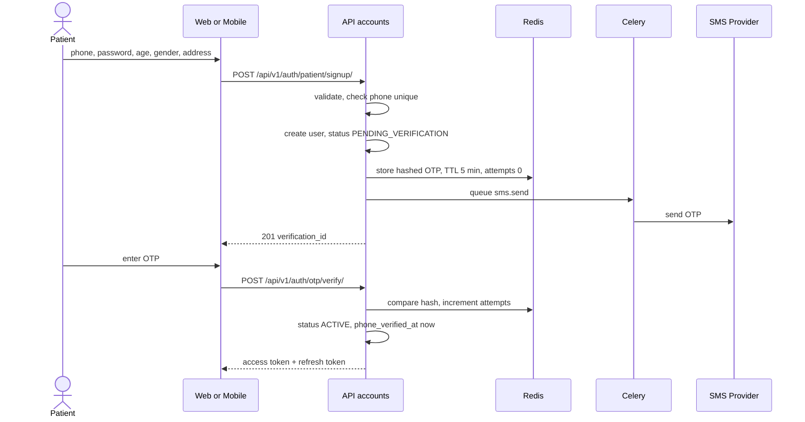

Web gets the refresh token as an httpOnly cookie; mobile gets it in the body and stores it in the OS keystore.

### 2.2 Doctor sign-up and approval

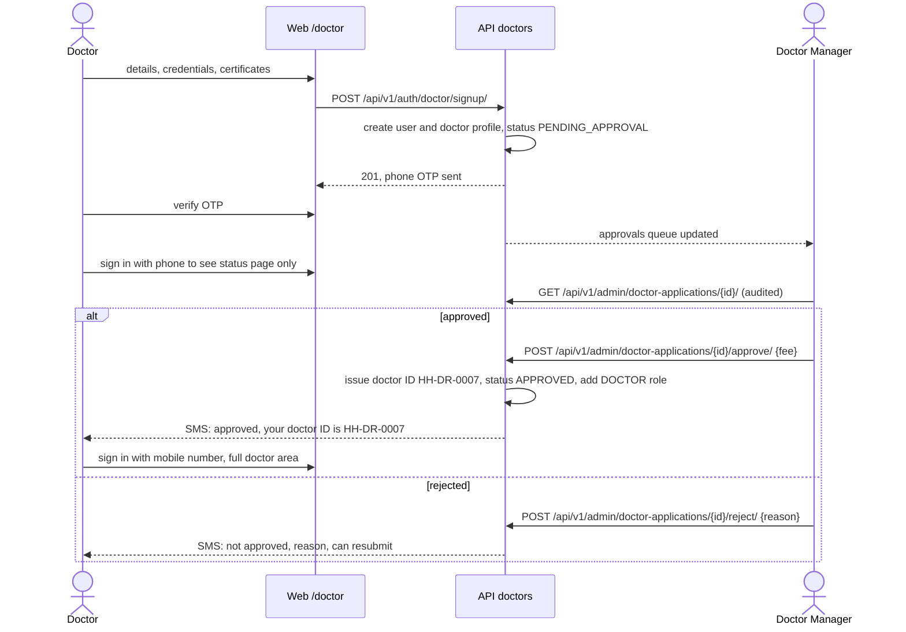

Before approval a doctor can sign in (with phone) only to see and edit their application; every other `/doctor` endpoint returns `403 DOCTOR_NOT_APPROVED`.

### 2.3 Self-consultancy → purchase (online or COD)

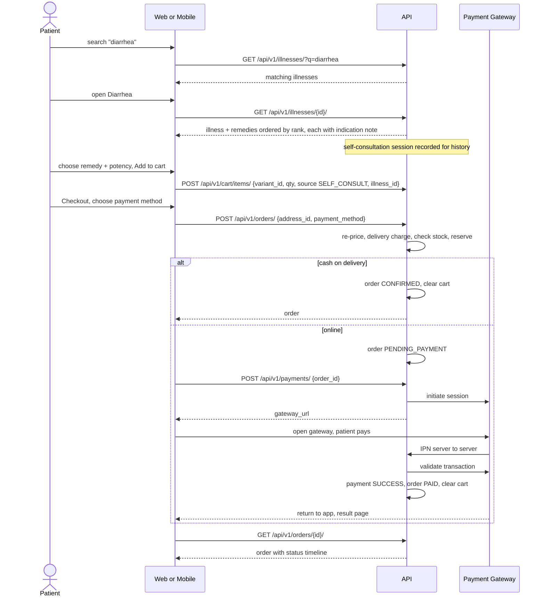

### 2.4 Doctor-consultancy end-to-end

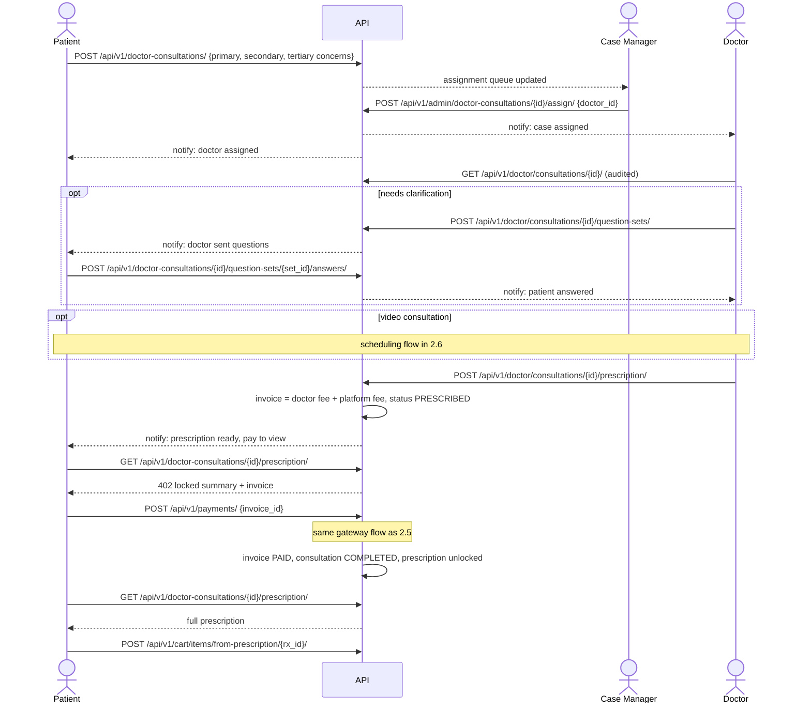

At any point before `COMPLETED` the patient may call `POST /api/v1/doctor-consultations/{id}/withdraw/`; open appointments are cancelled and the doctor is notified.

### 2.5 Payment (gateway-agnostic, SSLCommerz-compatible)

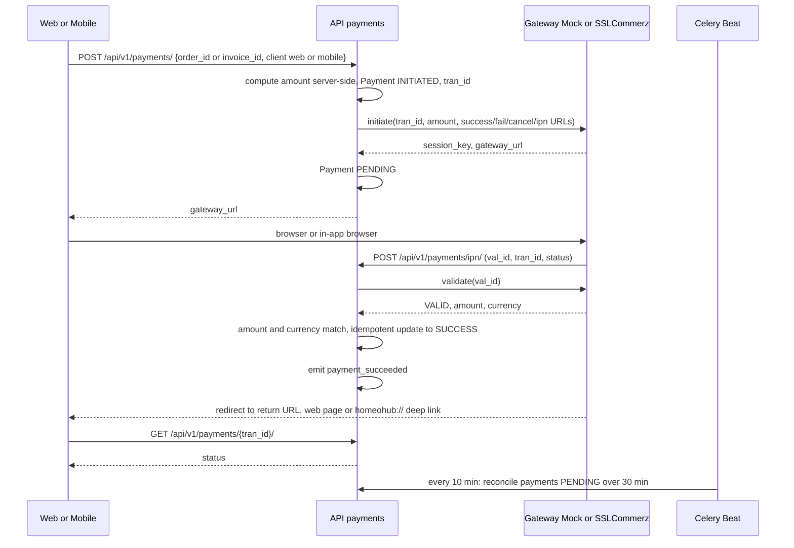

**Mock gateway (development):** the API serves `/mock-gateway/checkout/{session_key}/`, a simple page with **Pay successfully / Fail / Cancel** buttons. Clicking a button calls the real IPN endpoint and then redirects to the return URL — so the whole flow, including idempotency, validation and the mobile deep-link return, is exercised before SSLCommerz is connected.

### 2.6 Video appointment scheduling and call

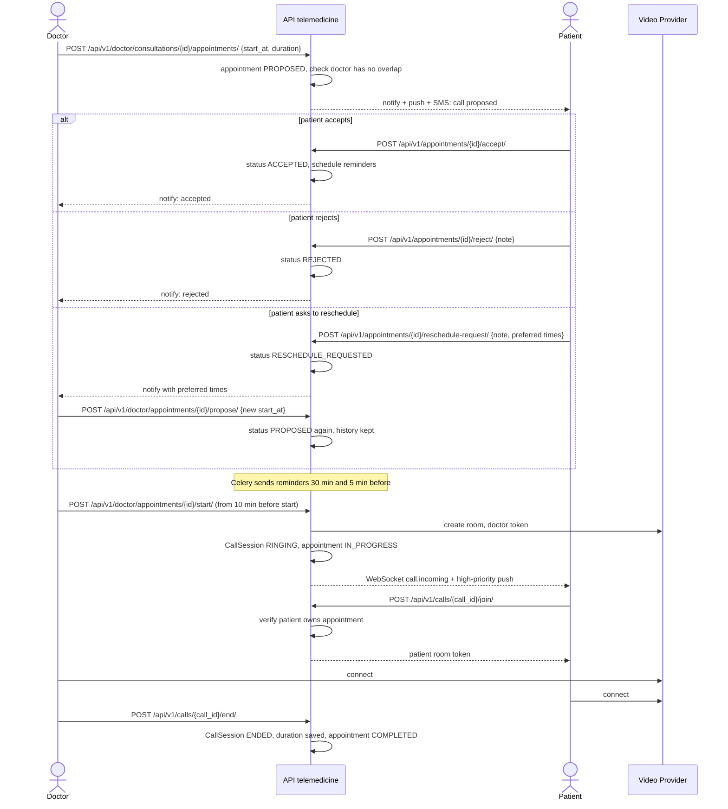

- Patient not joining within 10 min of the start → doctor can mark `NO_SHOW` or re-propose.
- Doctor can redial within the appointment window if the call drops (new `CallSession`, same appointment).
- Only the doctor can start a call; the patient's "Join" button is active only while a call is ringing or live.

---

## 3. State Machines

### 3.1 Doctor consultation

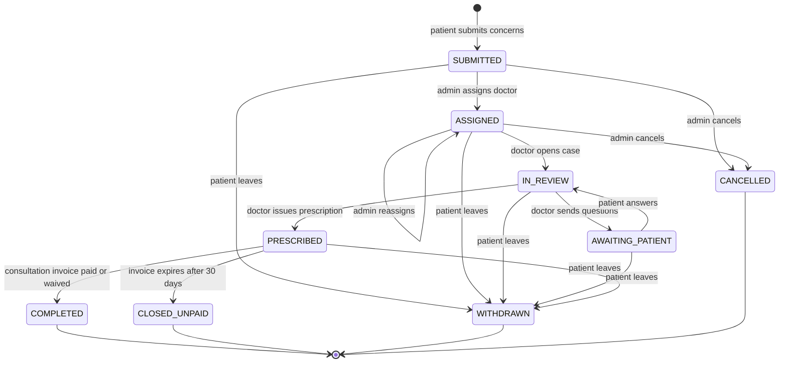

- Video appointments happen in `IN_REVIEW` or `AWAITING_PATIENT`; they do not change the consultation's state.
- `AWAITING_PATIENT` has no auto-cancel: the patient may leave whenever they want (product decision). Reminders are sent on day 2 and day 7.
- A follow-up ("report after") creates a **new consultation linked to the previous one** (`parent_id`), pre-assigned to the same doctor.
- Every transition is written to `consultation_status_history` (from, to, actor, reason, time).

### 3.2 Doctor account

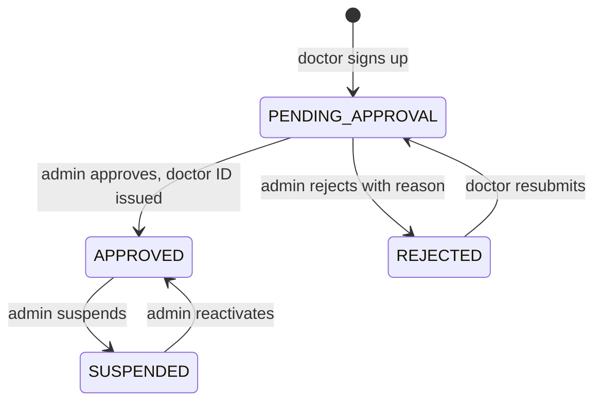

A suspended doctor cannot sign in. Their open doctor consultations go back to the assignment queue.

### 3.3 Video appointment

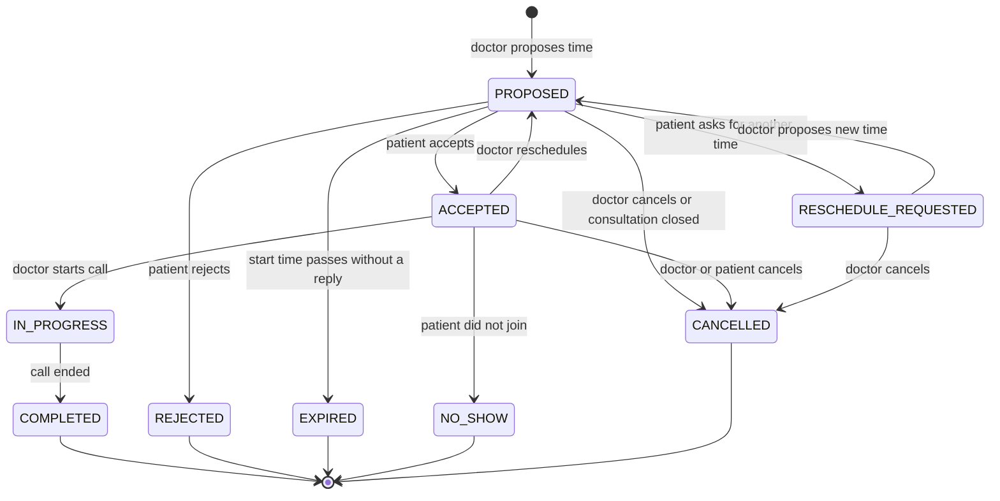

Every proposal, reply and note is kept in `appointment_events`, so both sides see the full back-and-forth.

### 3.4 Order

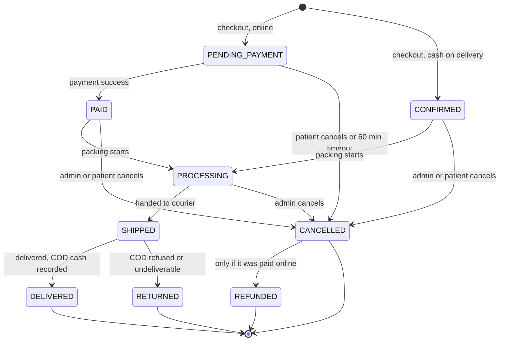

- Stock is **reserved** at checkout, **committed** on `PAID` / `CONFIRMED`, **released** on `CANCELLED`, **returned** on `RETURNED`.
- Patients can cancel only before `PROCESSING`.
- For COD, marking `DELIVERED` requires the collected amount; this creates a `COD` payment record.

### 3.5 Payment

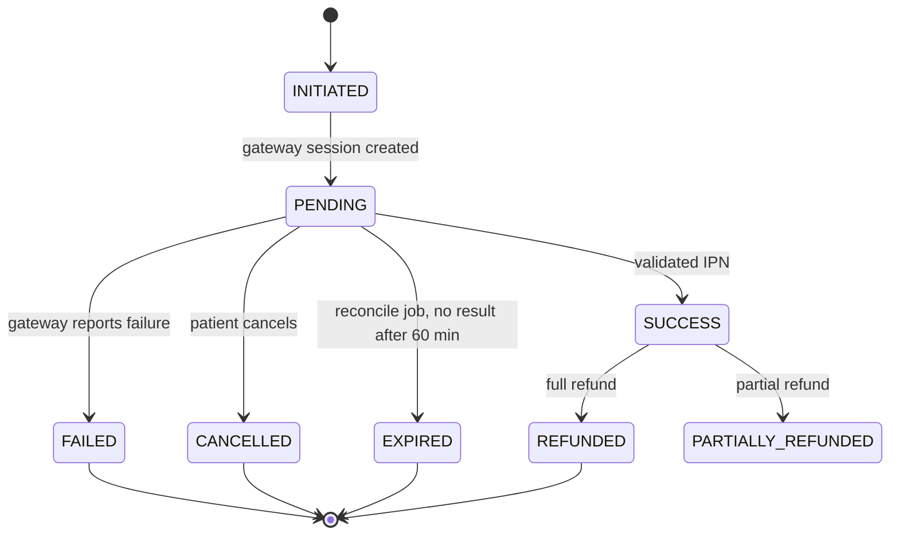

COD payments are created directly in `SUCCESS` (method `COD`) when fulfilment records the cash. A failed online payment does not fail the order — the patient can retry; each attempt is a new Payment row.

### 3.6 Consultation invoice

`UNPAID → PAID` (unlocks prescription) · `UNPAID → WAIVED` (admin; unlocks) · `UNPAID → VOID` (consultation withdrawn) · `UNPAID → EXPIRED` (30 days unpaid).

---

## 4. Business Rules

### Accounts
- BR-01 Phone numbers are unique per user type, normalised to E.164 (`+8801XXXXXXXXX`).
- BR-02 One account belongs to one person. No dependent profiles.
- BR-03 Patient must be phone-verified before checkout or submitting a consultation.
- BR-04 Age is stored as **date of birth** (age is derived). Sign-up asks for age and stores an approximate DOB that the patient can correct.
- BR-05 Doctor IDs are system-generated on approval (`HH-DR-` + 4 digits) and never change.
- BR-06 A doctor who is not `APPROVED` can access only their own application.
- BR-07 Each user has a preferred language (`bn` / `en`) used for UI default, SMS and push.

### Remedies
- BR-10 A **Remedy** (e.g. *Arsenicum album*) has one or more **Variants** (potency 6C/30C/200C/1M × form globules/dilution × pack size), each with price and stock. Only variants are sold.

### Illnesses & recommendations
- BR-11 An illness lists remedies through **Illness Recommendation** rows: `rank` (1 = most likely), optional `match_score` (0–100), and an `indication` note (bn + en) that tells the patient when this remedy fits.
- BR-12 Recommendations are shown ordered by `rank`; remedies with no in-stock variant are shown greyed as "currently unavailable".

### Remedies and illnesses (both)
- BR-13 Only `ACTIVE` illnesses and remedies are visible to patients.
- BR-14 Translatable content has `_en` and `_bn` fields; English is required, Bangla falls back to English when empty.

### Cart & orders
- BR-20 One active cart per patient (shared between web and mobile); adding an existing variant increases quantity (max 10 per line).
- BR-21 Each cart item records its **source** (`SELF_CONSULT`, `PRESCRIPTION`, `FINDER`) and source ID.
- BR-22 At checkout prices are recomputed from the remedies module and **snapshotted** into order items; the delivery address is snapshotted into the order.
- BR-23 Order total = Σ items + delivery charge − discount. Delivery charge comes from the **delivery rule table** (flat, by zone/district, free above an amount) — values to be decided.
- BR-24 Payment method: `ONLINE` or `COD`. COD may later be limited by amount or zone via settings.
- BR-25 Unpaid online orders auto-cancel after 60 min and release stock.

### Consultations
- BR-30 Primary concern is required; secondary and tertiary are optional. Each concern has a category (digestive, skin, respiratory, mental/emotional, women's health, child health, …) and free text.
- BR-31 A patient may have at most 3 open doctor consultations at once.
- BR-32 Only `APPROVED` doctors can be assigned. The assignment screen shows each doctor's open-case count.
- BR-33 A doctor sees a patient's profile and history only through a consultation assigned to them (current or past).
- BR-34 Doctor's **clinical notes** are never shown to patients.
- BR-35 The patient may **withdraw** at any state before `COMPLETED`. Nothing is charged; any unpaid invoice is voided; open appointments are cancelled.
- BR-36 A prescription is **immutable** once issued. Corrections create a new version linked to the previous one; the patient sees the latest.
- BR-37 Consultation fee = doctor's fee + platform fee. Platform fee is a setting: `FIXED` amount or `PERCENT` of doctor fee (default 0 until decided). Both parts are **snapshotted** on the invoice.
- BR-38 Until the invoice is `PAID`/`WAIVED`, the patient API returns only: doctor name, issue date, number of remedies, fee breakdown.
- BR-39 Prescription items link to a remedy in the remedies module (and preferably a variant). Items that are not listed there are shown but cannot be bought.

### Video appointments
- BR-40 Only the assigned doctor can propose, reschedule or start an appointment; only the patient can accept, reject or request a reschedule.
- BR-41 A doctor cannot have two appointments that overlap. Default duration 20 min (doctor can choose 10–60).
- BR-42 Proposed times must be at least 30 min in the future. A proposal not answered before its start time becomes `EXPIRED`.
- BR-43 A consultation has at most one active (`PROPOSED`, `RESCHEDULE_REQUESTED`, `ACCEPTED`) appointment at a time.
- BR-44 The doctor can start the call from 10 min before until 15 min after the start time.

### Questionnaires
- BR-50 Templates are tagged with concern categories; templates matching the consultation's categories are suggested first.
- BR-51 Question types: short text, long text, single choice, multiple choice, yes/no, scale 1–10, date, photo upload.
- BR-52 A sent question set is a frozen copy, so later template edits don't change what the patient saw.
- BR-53 The patient submits all answers in one go; drafts are saved on the device.

### Payments
- BR-60 Amounts are computed on the server; the client never sends an amount.
- BR-61 Status changes only after gateway validation (IPN or validate API); duplicate IPNs are ignored (idempotent on `tran_id`).
- BR-62 Paid amount and currency must match exactly; mismatches are flagged for Finance and not auto-applied.
- BR-63 Consultation invoices can be paid online only (no COD).

---

## 5. Domain Model Overview

Entities grouped by module (full attributes, keys and relationships come in the data dictionary and ER diagram).

| Module | Entities |
|---|---|
| accounts | `User` (custom, `user_type`), `Group` (role), `Permission`, `RefreshToken` (blacklist), `OtpChallenge` (Redis), `StaffProfile`, `DeviceToken` |
| patients | `PatientProfile`, `Address`, `FamilyHistoryEntry`, `MedicalHistoryEntry`, `MentalPicture`, `GeneralPicture`, `Preference` (likes/dislikes) |
| doctors | `DoctorProfile` (doctor ID, status, registration no., qualifications, fee), `DoctorSpeciality`, `DoctorDocument`, `DoctorApprovalEvent` |
| remedies | `Remedy`, `RemedyVariant`, `RemedyImage` |
| illnesses | `IllnessCategory`, `Illness`, `IllnessRecommendation` |
| self_consultation | `SelfConsultation` |
| doctor_consultancy | `DoctorConsultation`, `ConsultationConcern`, `ConsultationAttachment`, `ConsultationStatusHistory`, `DoctorNote` |
| questionnaires | `QuestionTemplate`, `QuestionTemplateSet`, `QuestionSet`, `Question`, `Answer` |
| prescriptions | `Prescription`, `PrescriptionItem`, `PrescriptionAdvice` (do / don't) |
| telemedicine | `VideoAppointment`, `AppointmentEvent`, `CallSession` |
| billing | `ConsultationInvoice` |
| cart / orders | `Cart`, `CartItem`, `Order`, `OrderItem`, `OrderStatusHistory`, `StockMovement`, `DeliveryRule` |
| payments | `Payment` (method `ONLINE` / `COD`), `PaymentEvent` (raw gateway callbacks) |
| notifications | `Notification`, `NotificationTemplate` (bn + en) |
| media | `FileObject` |
| platform | `Setting`, `AuditLog`, `AppVersionPolicy` |

Key relationships:

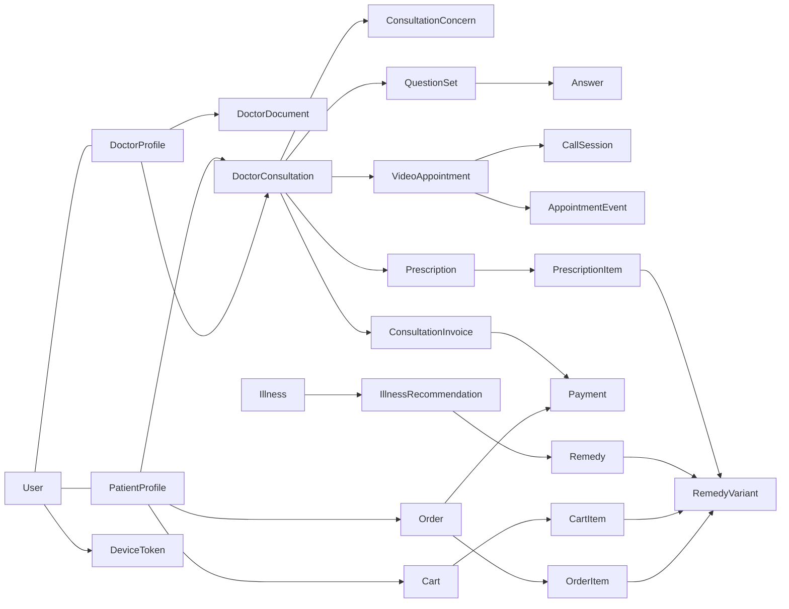

---

## 6. API Design

### 6.1 Conventions

- Base path `/api/v1/` (see §6.2), JSON, DRF routers (trailing slash). OpenAPI 3 from drf-spectacular at `/api/v1/schema/`, Swagger UI at `/api/v1/docs/` (non-prod).
- Same API for web and mobile. Clients send `X-Client: web | android | ios` and `X-App-Version` (mobile).
- Route prefixes by audience: patient/public routes, `/api/v1/doctor/…` (approved doctors), `/api/v1/admin/…` (staff permissions).
- Lists: `?q=&page=1&page_size=20&ordering=-created_at&<filters>` → `{ "results": [...], "count": n, "next": url, "previous": url }`.
- Errors: `{ "error": { "code": "ORDER_NOT_PAYABLE", "message": "...", "details": {...}, "request_id": "..." } }` with standard HTTP status (custom DRF exception handler).
- IDs: UUID primary keys. Human-friendly codes where people read them aloud: doctor `HH-DR-0007`, order `HH-ORD-240117`, consultation `HH-C-000123`.
- Idempotency: `Idempotency-Key` header accepted on `POST /api/v1/orders/` and `POST /api/v1/payments/`.
- Money: integer poisha + `"currency": "BDT"`.
- Language: `Accept-Language: bn | en` picks translated fields.

### 6.2 API Versioning

**Scheme: major version in the URL path.**

| Surface | Versioned path |
|---|---|
| REST API | `/api/v1/…` |
| WebSocket | `/ws/v1/` |
| OpenAPI schema / docs | `/api/v1/schema/` · `/api/v1/docs/` |
| Payment gateway callbacks (IPN, success/fail/cancel) | `/api/v1/payments/…` |
| Not versioned | `/health/*`, `/mock-gateway/*`, `/.well-known/*` (app links) |

Why path versioning: it is visible in logs and links, works with caches and the gateway's fixed callback URLs, and lets the Flutter app pin the version it was built against.

**Django / DRF setup**

```python
# config/settings/base.py
REST_FRAMEWORK = {
    "DEFAULT_VERSIONING_CLASS": "rest_framework.versioning.URLPathVersioning",
    "DEFAULT_VERSION": "v1",
    "ALLOWED_VERSIONS": ["v1"],
    "VERSION_PARAM": "version",
}
API_REVISION = "1.0.0"  # bumped on every backward-compatible contract change

# config/urls.py
urlpatterns = [
    re_path(r"^api/(?P<version>v1)/", include("config.api_v1")),
    path("ws/v1/", include("config.ws_v1")),  # Channels routing
]
```

- Each app keeps its HTTP layer per version: `apps/<app>/api/v1/{serializers,views,urls}.py`. Services, selectors and models are **version-free**, so a new API version reuses all business logic.
- `config/api_v1.py` collects every app's v1 routes. A future `config/api_v2.py` includes v1's routes and overrides only the endpoints whose contract changed.
- Requests for an unknown version return `404 API_VERSION_NOT_SUPPORTED`.
- Every response carries `X-API-Version: v1` and `X-API-Revision: 1.0.0`.

**What needs a new major version**

| Allowed inside v1 (non-breaking) | Requires v2 (breaking) |
|---|---|
| New endpoint | Removing or renaming an endpoint or field |
| New optional request field or query parameter | New required request field |
| New response field | Changing a field's type or meaning |
| New enum value (clients treat unknown values as "other") | Changing error codes or status codes for existing cases |
| New error code for a new situation | Changing pagination, auth or envelope format |

Client rules that make this work: ignore unknown fields; map unknown enum values to an "unknown" case (`@JsonKey(unknownEnumValue: …)` in Dart, a default branch in TypeScript); never depend on field order.

**Version lifecycle**

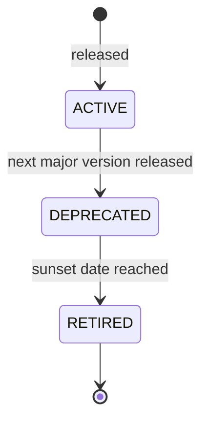

- **Deprecated** versions keep working and add `Deprecation` and `Sunset` response headers plus a `Link` to migration notes.
- A version is retired no earlier than **6 months** after deprecation **and** only after `/api/v1/app-config/` has forced mobile users onto an app build that uses the newer version, and the old version's traffic is under 2 %. Retired versions return `410 API_VERSION_RETIRED`.
- Payments keep the callback URL of the version that started them (`Payment.callback_base_url`), so the old IPN route stays until every payment started on it is settled.
- Request metrics are labelled by API version to track usage.

**Contract checks in CI**

- The OpenAPI schema of each active version is committed (`backend/schema/v1.yaml`) and regenerated in CI.
- `oasdiff breaking` compares it with `main`; a breaking change to an existing version fails the build.
- Generated clients are pinned per version: `web/src/api/v1/` and `mobile/lib/core/api/v1/`.

### 6.3 Endpoint list (v1)

All paths below are shown in full, under `/api/v1/`.

**Auth**
| Method | Path | Who |
|---|---|---|
| POST | `/api/v1/auth/patient/signup/` | public |
| POST | `/api/v1/auth/doctor/signup/` | public |
| POST | `/api/v1/auth/otp/verify/` · `/api/v1/auth/otp/resend/` | public |
| POST | `/api/v1/auth/patient/login/` | public |
| POST | `/api/v1/auth/doctor/login/` (mobile number + password) | public |
| POST | `/api/v1/auth/staff/login/` | public |
| POST | `/api/v1/auth/refresh/` · `/api/v1/auth/logout/` | any |
| POST | `/api/v1/auth/password/forgot/` · `/api/v1/auth/password/reset/` · `/api/v1/auth/password/change/` | any |
| GET/PATCH | `/api/v1/me/` (incl. preferred language) | any |
| POST/DELETE | `/api/v1/me/devices/` (push token register / remove) | mobile |
| GET | `/api/v1/app-config/` (min app version, feature flags, settings needed by clients) | public |

**Patient profile & history**
| Method | Path |
|---|---|
| GET/PATCH | `/api/v1/me/profile/` |
| PUT | `/api/v1/me/profile/picture/` |
| CRUD | `/api/v1/me/addresses/` |
| GET/PUT | `/api/v1/me/profile/family-history/` · `medical-history/` · `mental-picture/` · `general-picture/` · `preferences/` |
| GET | `/api/v1/me/history/` (combined timeline) |

**Illnesses (public read)**
| Method | Path |
|---|---|
| GET | `/api/v1/illnesses/?q=&category=` · `/api/v1/illnesses/{id}/` (with ranked remedies) |
| GET | `/api/v1/illness-categories/` |

**Remedies (public read)**
| Method | Path |
|---|---|
| GET | `/api/v1/remedies/?q=` · `/api/v1/remedies/{id}/` (with variants) |

**Self-consultation**
| Method | Path |
|---|---|
| POST | `/api/v1/self-consultations/` `{illness_id}` |
| GET | `/api/v1/self-consultations/?q=` |

**Cart & orders**
| Method | Path |
|---|---|
| GET | `/api/v1/cart/` |
| POST | `/api/v1/cart/items/` · `/api/v1/cart/items/from-prescription/{prescription_id}/` |
| PATCH/DELETE | `/api/v1/cart/items/{id}/` |
| POST | `/api/v1/orders/quote/` (delivery charge + total for an address) |
| POST | `/api/v1/orders/` `{address_id, payment_method}` |
| GET | `/api/v1/orders/?q=&status=` · `/api/v1/orders/{id}/` |
| POST | `/api/v1/orders/{id}/cancel/` |

**Consultations (patient)**
| Method | Path |
|---|---|
| POST | `/api/v1/doctor-consultations/` |
| GET | `/api/v1/doctor-consultations/?q=&status=` · `/api/v1/doctor-consultations/{id}/` |
| POST | `/api/v1/doctor-consultations/{id}/attachments/` |
| POST | `/api/v1/doctor-consultations/{id}/withdraw/` |
| GET | `/api/v1/doctor-consultations/{id}/question-sets/` |
| POST | `/api/v1/doctor-consultations/{id}/question-sets/{set_id}/answers/` |
| GET | `/api/v1/doctor-consultations/{id}/prescription/` (402 + locked summary until paid) |

**Appointments & calls (patient)**
| Method | Path |
|---|---|
| GET | `/api/v1/appointments/?status=` · `/api/v1/appointments/{id}/` (with event history) |
| POST | `/api/v1/appointments/{id}/accept/` · `…/reject/` · `…/reschedule-request/` · `…/cancel/` |
| POST | `/api/v1/calls/{call_id}/join/` |

**Payments**
| Method | Path |
|---|---|
| POST | `/api/v1/payments/` `{order_id}` or `{invoice_id}` → `{gateway_url}` |
| GET | `/api/v1/payments/{tran_id}/` |
| POST | `/api/v1/payments/ipn/` (gateway → server) |
| GET/POST | `/api/v1/payments/return/success/` · `…/fail/` · `…/cancel/` (redirect to web page or app deep link) |
| GET | `/mock-gateway/checkout/{session_key}/` (dev/staging only) |

**Doctor** (`/api/v1/doctor/…`, approved doctors; application endpoints open to pending doctors)
| Method | Path |
|---|---|
| GET/PATCH | `/api/v1/doctor/application/` · POST `/api/v1/doctor/application/documents/` · POST `/api/v1/doctor/application/resubmit/` |
| GET/PATCH | `/api/v1/doctor/profile/` |
| GET | `/api/v1/doctor/dashboard/` |
| GET | `/api/v1/doctor/consultations/?q=&status=` · `/api/v1/doctor/consultations/{id}/` |
| GET | `/api/v1/doctor/patients/?q=` · `/api/v1/doctor/patients/{id}/` (profile + history, assigned only) |
| GET | `/api/v1/doctor/question-templates/?q=&category=` |
| POST | `/api/v1/doctor/consultations/{id}/question-sets/` |
| GET/POST | `/api/v1/doctor/consultations/{id}/notes/` |
| POST | `/api/v1/doctor/consultations/{id}/appointments/` |
| GET | `/api/v1/doctor/appointments/?date=&status=` |
| POST | `/api/v1/doctor/appointments/{id}/propose/` · `…/cancel/` · `…/start/` · `…/no-show/` |
| POST | `/api/v1/calls/{call_id}/end/` |
| POST | `/api/v1/doctor/consultations/{id}/prescription/` · `/api/v1/doctor/prescriptions/{id}/revise/` |

**Admin** (`/api/v1/admin/…`, permission per route)
| Area | Paths |
|---|---|
| Doctor approvals | `GET /api/v1/admin/doctor-applications/?status=&q=` · `GET …/{id}/` · `POST …/{id}/approve/` · `POST …/{id}/reject/` |
| Doctors | `GET/PATCH /api/v1/admin/doctors/` · `POST /api/v1/admin/doctors/{id}/suspend/` · `…/reactivate/` · `…/reset-password/` |
| Assignment | `GET /api/v1/admin/doctor-consultations/?status=SUBMITTED&q=` · `POST /api/v1/admin/doctor-consultations/{id}/assign/` · `POST …/cancel/` |
| Patients | `GET /api/v1/admin/patients/?q=` · `GET /api/v1/admin/patients/{id}/` · `POST …/block/` |
| Remedies | CRUD `/api/v1/admin/remedies/`, `/api/v1/admin/remedies/{id}/variants/`, `/api/v1/admin/remedies/{id}/images/` |
| Illnesses | CRUD `/api/v1/admin/illnesses/`, `/api/v1/admin/illnesses/{id}/recommendations/`, `/api/v1/admin/illness-categories/` |
| Questionnaires | CRUD `/api/v1/admin/question-templates/`, `/api/v1/admin/question-template-sets/` |
| Orders | `GET /api/v1/admin/orders/?q=&status=` · `POST /api/v1/admin/orders/{id}/status/` · `POST …/cod-collected/` · `POST …/refund/` |
| Payments & invoices | `GET /api/v1/admin/payments/?q=` · `POST /api/v1/admin/payments/{id}/reconcile/` · `POST /api/v1/admin/invoices/{id}/waive/` |
| RBAC | CRUD `/api/v1/admin/staff/`, `/api/v1/admin/roles/`; `GET /api/v1/admin/permissions/` |
| Settings | `GET/PATCH /api/v1/admin/settings/` · CRUD `/api/v1/admin/delivery-rules/` |
| Audit / reports | `GET /api/v1/admin/audit-logs/?q=` · `GET /api/v1/admin/reports/…` |
| Media | `POST /api/v1/media/upload-url/` → signed PUT URL |

### 6.4 Realtime (WebSocket `/ws/v1/`)

Authenticated with the access token. Each user joins group `user.{id}`; staff with assignment or approval permissions also join `queue.assignment` / `queue.doctor_approvals`.

| Event | Direction | Payload |
|---|---|---|
| `notification.new` | server → client | notification |
| `appointment.updated` | server → client | appointment id, status |
| `call.incoming` / `call.ended` | server → client | call id, consultation id, doctor |
| `doctor_consultation.updated` | server → client | id, status |
| `queue.updated` | server → staff | counts |

Mobile also gets the same events as push notifications when the app is in the background.

---

## 7. Background Jobs (Celery)

| Task | Trigger | What it does |
|---|---|---|
| `notifications.send_sms` | event | Send SMS via provider; retry ×3 with backoff |
| `notifications.send_push` | event | Send FCM message; drop invalid device tokens |
| `payments.reconcile` | beat, every 10 min | Re-validate `PENDING` payments older than 30 min; expire after 60 min |
| `orders.expire_unpaid` | beat, every 5 min | Cancel online `PENDING_PAYMENT` orders older than 60 min, release stock |
| `doctor_consultancy.answer_reminder` | beat, daily | Remind patients with unanswered questions (day 2, day 7) |
| `billing.pay_reminder` | beat, daily | Remind that a prescription is waiting (day 1, day 3, day 7) |
| `billing.expire_invoices` | beat, daily | Unpaid invoice after 30 days → `EXPIRED`, consultation → `CLOSED_UNPAID` |
| `telemedicine.appointment_reminders` | scheduled at accept time | Remind both sides 30 min and 5 min before |
| `telemedicine.expire_proposals` | beat, every 5 min | Unanswered proposals past start time → `EXPIRED` |
| `prescriptions.follow_up_reminder` | beat, daily | Notify patient and doctor when report-after date arrives |
| `media.process_upload` | upload complete | Validate file, make thumbnails, strip EXIF location data |

---

## 8. Screen Inventory

### 8.1 Patient (web `/` and mobile app)

| Area | Screens |
|---|---|
| Onboarding | Language choice · Welcome · Sign up · Verify OTP · Sign in · Forgot password |
| Home | Two big entry points: **"Find a remedy myself"** and **"Consult a doctor"**; search bar; upcoming appointment card; ongoing consultation card; recent orders |
| Self-consultancy | Illness list (search, categories) · Illness detail with ranked remedy cards (indication note, potency picker, add to cart) |
| Remedy | Remedy detail (picture, description, variants) |
| Consult a doctor | New consultation (3 concerns + attachments) · My doctor consultations · Doctor consultation detail (timeline, questions to answer, appointment card, prescription card, withdraw) · Answer questionnaire · Appointment detail (accept / reject / ask to reschedule) · Incoming call · Video call · Prescription (locked → pay → unlocked, "Add all to cart") |
| Commerce | Cart · Checkout (address, delivery charge, online or COD) · Payment result · My orders · Order detail with status timeline |
| Profile | Overview · Basic info · Picture · Family history · Medical history · Mental picture · General picture · Likes/dislikes · Addresses |
| Other | Notifications · History timeline · Settings (language, notifications, sign out) |

### 8.2 Doctor (web `/doctor`)

Sign up · Application status / resubmit · Sign in · Dashboard (queue by status, today's appointments, follow-ups due) · Doctor consultation workspace (concerns, patient case summary, history, questions tab, appointments tab, notes, prescribe) · Appointment scheduler (calendar of own appointments, propose / reschedule) · Video call · Prescription editor (remedy search, potency, dosage, do's/don'ts, report-after) · My patients · Patient detail · Profile

### 8.3 Admin (web `/admin`)

| Role | Screens |
|---|---|
| Doctor manager | Doctor applications (documents viewer, approve / reject) · Doctors list · Doctor detail (suspend, fee) |
| Case manager | Assignment queue · Doctor consultation detail · Doctor load view |
| Remedy manager | Remedies · Remedy editor (variants, prices, images, bn/en) |
| Illness manager | Illness categories · Illnesses · Illness editor (ranked recommendations, drag to reorder, bn/en) · Question templates |
| Fulfilment | Orders board by status · Order detail (status, COD collection) · Stock |
| Finance | Payments · Invoices · Refunds · Reports |
| Super admin | Staff · Roles & permissions matrix · Settings (platform fee, delivery rules, templates, min app version) · Audit log |

Every list screen uses the shared searchable, paginated table.

---

## 9. AI Remedy Finder — reserved design

Not built in v1, but the slot exists so adding it later is additive:

- `RemedyFinder` interface: `find(patient_description, profile_context) → [{remedy_id, score, rationale}]`.
- v1 binding: `DisabledRemedyFinder` (feature flag off via `/api/v1/app-config/`, entry point hidden in web and mobile).
- Later binding: LLM-backed service that retrieves candidates from the remedies and illnesses modules, returns only remedies that exist in the remedies module, and logs every query/result for doctor review.
- Results feed the cart with `source = FINDER`, so analytics and history work unchanged.

---

## 10. Delivery Plan (suggested phases)

| Phase | Backend + web | Mobile (Flutter) |
|---|---|---|
| **0. Foundation** | Repo, Docker Compose (Postgres, Redis, MinIO), CI, accounts (3 login types, OTP mock, RBAC), audit log, shared search/list, i18n setup | Project setup, flavors, theme, bn/en, API client generation, auth screens |
| **1. Remedies, illnesses & self-consultancy** | Remedies/variants, illnesses + ranked recommendations, admin remedy and illness screens, patient illness/remedy screens | Illness library, illness detail, remedy detail |
| **2. Commerce** | Cart, checkout, COD + mock gateway, orders, fulfilment, notifications | Cart, checkout, payment via in-app browser + deep link, orders, push |
| **3. Doctor onboarding & consultancy** | Doctor sign-up + approvals, assignment queue, doctor area, questionnaires, prescriptions, invoice + unlock | Consult a doctor, answer questions, prescription unlock |
| **4. Telemedicine** | Appointment scheduling, reminders, video calls | Appointment accept/reject/reschedule, incoming call, video |
| **5. Hardening & launch** | Profile completeness, reports, security review, load test, SSLCommerz sandbox → live, real SMS | Profile screens, crash reporting, Play Store release (then App Store) |
| **Later** | AI Remedy Finder, courier API | Doctor mode in the app, AI Remedy Finder |
