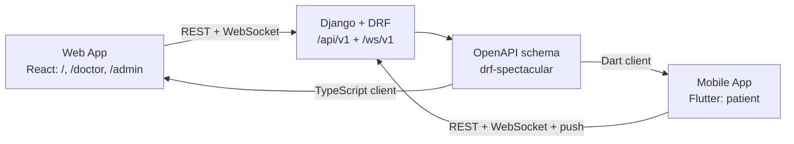
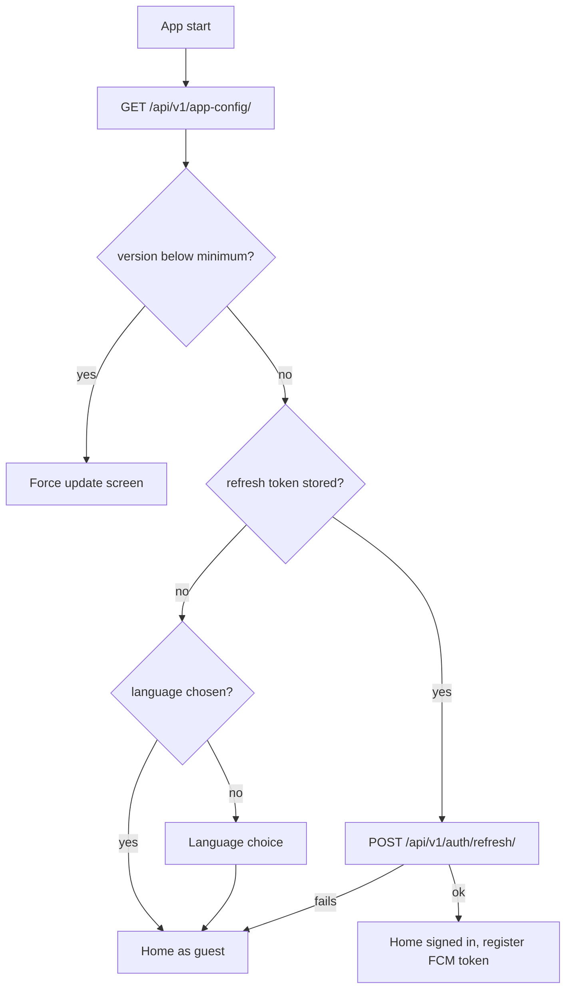
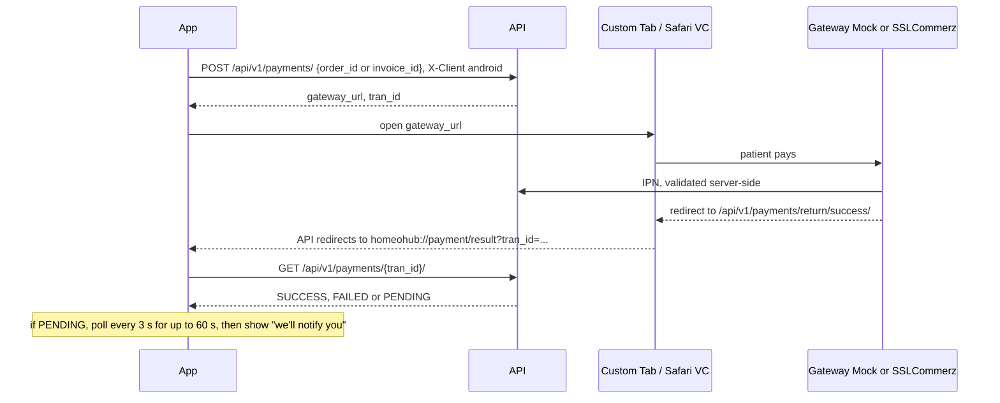

# HomeoHub — Mobile App Plan (Flutter)

> Version 0.1 · 2026-11-11 · Status: Draft for review
> Read with [01-architecture.md](01-architecture.md) and [02-system-design.md](02-system-design.md).

---

## 1. Principle: one backend, two front-ends



- The mobile app has **no business logic of its own**: prices, stock, fees, prescription locking, appointment rules and permissions all live in the API. The app only displays and collects.
- Both clients are generated from the same OpenAPI schema, so a backend change that breaks a client fails CI.
- The cart, profile, doctor consultations and orders are server-side, so a patient can start on the phone and finish on the web (or the other way round).

---

## 2. Scope

| Release | Features |
|---|---|
| **v1 — Patient app** | Everything in the patient area of the web app: sign-up/in with OTP, profile, illness library, ranked remedies, cart, checkout (online + COD), orders and tracking, consult a doctor, questionnaires, appointment accept/reject/reschedule, video calls, prescription unlock, history, notifications, Bangla/English |
| **Mobile-only extras in v1** | Push notifications, incoming-call screen, deep links (payment return, notification taps), camera upload for attachments, biometric unlock (optional), offline read of last-loaded remedies, illnesses and prescriptions |
| **v2 — Doctor mode** (optional) | Approved doctors sign in with doctor ID; queue, appointment calendar, video calls, read case summary. Prescription writing stays web-first |
| **Later** | AI Remedy Finder |

Admin features are web-only.

---

## 3. Technology

Matches the doctors-hub app so code and knowledge carry over.

| Concern | Package | Notes |
|---|---|---|
| State management | `flutter_riverpod` | Same as doctors-hub |
| Navigation + deep links | `go_router`, `app_links` | Routes mirror web paths (`/illnesses/:id`, `/doctor-consultations/:id`, …) so links work on both |
| HTTP | `dio` + generated client (`openapi-generator`, `dart-dio`) | Interceptors for auth, language, app version, retries |
| Models | `freezed` + `json_serializable` | Immutable models from the generated client |
| Token storage | `flutter_secure_storage` | Android Keystore / iOS Keychain (doctors-hub used `shared_preferences`; tokens move to secure storage here) |
| Simple preferences | `shared_preferences` | Language, onboarding seen |
| Localization | `flutter_localizations` + `intl`, ARB files `app_en.arb` / `app_bn.arb` | Same setup as doctors-hub (`l10n.yaml`) |
| Video | `livekit_client` | Same provider as web |
| Push | `firebase_messaging` + `flutter_local_notifications` | FCM; high-priority data message for incoming calls |
| Realtime | `web_socket_channel` | Same `/ws/v1/` events as web while app is open |
| Payment page | `flutter_custom_tabs` (Android Custom Tabs / iOS SFSafariViewController) | Opens gateway URL; returns via `homeohub://payment/result` deep link |
| Images | `cached_network_image`, `image_picker` | |
| Offline cache | `hive` (or `isar`) | Remedies, illnesses, last prescriptions |
| Biometric (optional) | `local_auth` | Unlock app without re-entering password |
| Crash reporting | `sentry_flutter` | |
| App info / updates | `package_info_plus`, `url_launcher` | Force-update check against `/api/v1/app-config/` |
| Testing | `flutter_test`, `mocktail`, `integration_test` | |

---

## 4. App Architecture

Feature-first folders, as in doctors-hub; each feature has `data` (API + repository), `application` (Riverpod providers/notifiers) and `presentation` (screens, widgets).

```
mobile/
├─ lib/
│  ├─ main_dev.dart · main_staging.dart · main_prod.dart   # flavors
│  ├─ app.dart
│  ├─ core/
│  │  ├─ config/        # base URLs, flavor config, feature flags from /app-config/
│  │  ├─ network/       # dio, interceptors (auth refresh, Accept-Language, X-App-Version)
│  │  ├─ api/           # generated OpenAPI client (do not edit)
│  │  ├─ auth/          # token store, session provider
│  │  ├─ router/        # go_router + deep-link handling + auth guards
│  │  ├─ push/          # FCM setup, notification routing
│  │  ├─ realtime/      # WebSocket client
│  │  ├─ storage/       # secure storage, offline cache
│  │  ├─ theme/         # colors, typography (Bangla font e.g. Hind Siliguri / Noto Sans Bengali)
│  │  └─ widgets/       # SearchableListView, error/empty states, money text, status chips
│  ├─ features/
│  │  ├─ onboarding/    # language choice, welcome
│  │  ├─ auth/          # sign up, OTP, sign in, forgot password
│  │  ├─ home/
│  │  ├─ illnesses/     # self-consultancy library + ranked remedies
│  │  ├─ remedies/
│  │  ├─ cart/
│  │  ├─ checkout/      # address, delivery quote, online / COD, payment return
│  │  ├─ orders/
│  │  ├─ doctor_consultancy/ # new, list, detail, withdraw
│  │  ├─ questionnaires/
│  │  ├─ appointments/  # accept / reject / reschedule
│  │  ├─ calls/         # incoming call, video room
│  │  ├─ prescriptions/ # locked view, pay, unlocked view, add to cart
│  │  ├─ profile/
│  │  ├─ notifications/
│  │  └─ settings/
│  └─ l10n/             # app_en.arb, app_bn.arb
├─ test/
└─ integration_test/
```

### 4.1 Request pipeline

Every request goes through the dio interceptors in this order:

1. Add `Authorization: Bearer <access>`, `Accept-Language`, `X-Client: android|ios`, `X-App-Version`.
2. On `401 TOKEN_EXPIRED` → one shared refresh call (`POST /api/v1/auth/refresh/` with the stored refresh token) → retry the original request. Refresh fails → clear session → sign-in screen.
3. On `426 APP_UPDATE_REQUIRED` → force-update screen.
4. Map the API error envelope to a typed `AppException` shown in the user's language.

### 4.2 Startup



---

## 5. Mobile-specific flows

### 5.1 Payment (online)



- The app never decides that a payment succeeded; it only reads the server's status.
- If the patient closes the tab without returning, the app checks the payment status when it comes back to the foreground; the push notification from the server is the final confirmation.
- SSLCommerz also offers a native Flutter SDK; it can replace the custom tab later behind the same `PaymentLauncher` interface.

### 5.2 Incoming video call

- When the doctor starts the call, the server sends a **high-priority FCM data message** `call.incoming` plus the WebSocket event.
- App in foreground → full-screen incoming-call screen with Join / Not now.
- App in background → high-priority notification with full-screen intent (Android) / time-sensitive notification (iOS) → tap opens the call screen.
- Join → `POST /api/v1/calls/{id}/join/` → LiveKit token → video room (camera/mic permissions asked at first appointment acceptance, not at call time).
- Later improvement: native call UI via CallKit (iOS) / ConnectionService (Android).

### 5.3 Notifications and deep links

| Push type | Opens |
|---|---|
| Doctor assigned / consultation updated | `/doctor-consultations/:id` |
| Questions sent | `/doctor-consultations/:id/questions/:setId` |
| Appointment proposed / changed / reminder | `/appointments/:id` |
| Incoming call | `/calls/:id` |
| Prescription ready | `/doctor-consultations/:id/prescription` |
| Payment result | `/payments/:tranId` |
| Order status | `/orders/:id` |

Universal links (`https://homeohub.com/...`) open the same screens when the app is installed, otherwise the web app — the paths match.

### 5.4 Offline behaviour

| Data | Offline |
|---|---|
| Illness library, remedies | Last loaded copy readable; "offline" banner; add-to-cart disabled |
| Unlocked prescriptions | Readable (cached, encrypted at rest) |
| Questionnaire drafts | Saved locally, submitted when online |
| Cart, checkout, payment, doctor consultations | Online only |

---

## 6. Backend support the mobile app needs

These are already in the system design; listed here so they are not missed:

| Need | Backend item |
|---|---|
| Token refresh without cookies | `/api/v1/auth/refresh/` accepts the refresh token in the body when `X-Client` is `android` / `ios` |
| Push | `DeviceToken` model, `POST/DELETE /api/v1/me/devices/`, `notifications.send_push` task |
| Force update / feature flags | `/api/v1/app-config/`, `AppVersionPolicy`, `426 APP_UPDATE_REQUIRED` |
| Payment return to app | Return endpoints redirect to `homeohub://payment/result` when the payment was started with a mobile `X-Client` |
| Deep links | Android `assetlinks.json` and iOS `apple-app-site-association` served from the web domain |
| Upload from camera | `POST /api/v1/media/upload-url/` signed URLs; server-side EXIF stripping |
| Backward compatibility | Additive changes only inside `/api/v1`; breaking changes go to `/api/v2` while v1 is kept until the minimum app version moves past it |

---

## 7. Security

- Tokens in Keystore/Keychain only; cleared on sign-out and on refresh failure.
- TLS only; certificate pinning considered for production.
- Prescription and profile screens use Android `FLAG_SECURE` (no screenshots / recent-apps preview).
- Cached clinical data encrypted (Hive encrypted box, key in secure storage).
- Optional biometric lock after 5 min in background.
- No health data in push notification text — notifications say "Your prescription is ready", never the content.
- Code obfuscation (`--obfuscate --split-debug-info`) on release builds.

---

## 8. Build, Test & Release

| Item | Plan |
|---|---|
| Flavors | `dev` (local API, mock payment), `staging` (staging API, Firebase staging), `prod` |
| App IDs | `com.homeohub.app` (prod), `.staging`, `.dev` suffixes so all three can be installed together |
| CI | GitHub Actions: `flutter analyze`, unit + widget tests, build APK on every PR touching `mobile/` |
| Testers | Staging build to Firebase App Distribution on each merge to `main` |
| Android release | Play Store first (most patients in Bangladesh use Android); fill the Play Console **health app declaration** and data-safety form; staged rollout 10 % → 50 % → 100 % |
| iOS release | App Store after Android is stable; privacy nutrition labels; physical-goods purchases may use external payment, consultation fees fall under a professional service |
| Versioning | Semantic version + build number; `/api/v1/app-config/` minimum version for forced updates |
| Monitoring | Sentry crash-free sessions target ≥ 99.5 %; FCM delivery stats |

---

## 9. Mobile Milestones

Aligned with the delivery phases in system design §10.

| Milestone | Deliverable |
|---|---|
| M0 | Project skeleton, flavors, theme, bn/en, generated API client, sign up / OTP / sign in / forgot password |
| M1 | Home, illness library, illness detail with ranked remedies, remedy detail, search |
| M2 | Cart, checkout (COD + mock gateway via custom tab + deep link), orders, push notifications |
| M3 | Consult a doctor, consultation list/detail, withdraw, questionnaires, prescription locked → pay → unlocked → add to cart |
| M4 | Appointments (accept / reject / reschedule), reminders, incoming call, video room |
| M5 | Profile sections, history, notifications inbox, offline cache, Sentry, Play Store release |
