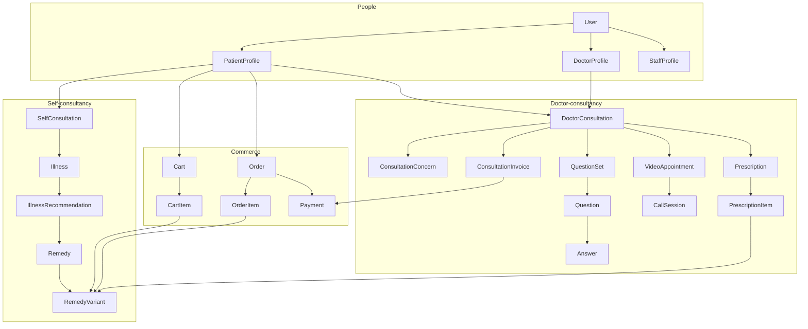

# HomeoHub — Domain Objects

> Version 0.1 · 2026-11-11 · Status: Draft for review
> The objects the system is built from. Detailed in [05-class-diagram.md](05-class-diagram.md), [06-data-dictionary.md](06-data-dictionary.md) and [07-er-diagram.md](07-er-diagram.md).

Objects come in four kinds:

| Kind | Meaning | Example |
|---|---|---|
| **Entity** | Stored in PostgreSQL, has an identity (UUID) and a lifecycle | `DoctorConsultation`, `Order` |
| **Value object** | No identity; describes something and is compared by value; stored inside an entity | `Money`, `PhoneNumber` |
| **Enumeration** | Fixed set of allowed values | `ConsultationStatus` |
| **Service / interface** | Behaviour, not data; not stored | `PaymentGateway`, `FeeCalculator` |

Every entity also has `id` (UUID), `created_at`, `updated_at`; they are not repeated below. Translatable text is written as `name_en/bn` (two columns).

---

## 1. Entities (58)

### 1.1 accounts — who can sign in

| Object | Purpose | Key attributes | Relations |
|---|---|---|---|
| **User** | One sign-in account for one person | `user_type` (PATIENT / DOCTOR / STAFF), `phone`, `username` (staff), `password` (hash), `status`, `preferred_language`, `phone_verified_at`, `last_login_at` | 1–1 PatientProfile **or** DoctorProfile **or** StaffProfile; M–N Role |
| **Role** | Named bundle of permissions (Django Group) | `name`, `description`, `is_system` | M–N Permission; M–N User |
| **Permission** | One allowed action | `codename` (e.g. `assign_consultation`), `app_label`, `name` | M–N Role |
| **StaffProfile** | Extra data for back-office staff | `full_name`, `email`, `totp_enabled`, `must_change_password` | 1–1 User |
| **DeviceToken** | A phone that can receive push | `platform` (ANDROID / IOS), `fcm_token`, `app_version`, `last_seen_at` | N–1 User |

Not tables of our own: **OtpChallenge** (kept in Redis: phone, purpose, code hash, attempts, expiry) and **refresh tokens** (SimpleJWT's outstanding/blacklisted token tables).

### 1.2 patients — the patient's case

| Object | Purpose | Key attributes | Relations |
|---|---|---|---|
| **PatientProfile** | The patient as a person | `full_name`, `gender`, `date_of_birth`, `dob_is_approximate`, `picture`, `completeness_pct` | 1–1 User; 1–N Address, FamilyHistoryEntry, MedicalHistoryEntry, Preference; 1–1 MentalPicture, GeneralPicture |
| **Address** | Delivery / contact address | `label`, `recipient_name`, `phone`, `line1`, `area`, `upazila_thana`, `district`, `division`, `postcode`, `is_default` | N–1 PatientProfile |
| **FamilyHistoryEntry** | Illness in the family | `relation` (FATHER, MOTHER, SIBLING, …), `condition`, `notes` | N–1 PatientProfile |
| **MedicalHistoryEntry** | Patient's own past/ongoing illness | `condition`, `since`, `status` (ONGOING / RESOLVED), `treatment`, `notes` | N–1 PatientProfile |
| **MentalPicture** | Homeopathic "mentals" | `temperament`, `fears`, `emotional_state`, `stress_response`, `dreams`, `notes` | 1–1 PatientProfile |
| **GeneralPicture** | Homeopathic "generals" | `thermal` (HOT / CHILLY / NEUTRAL), `appetite`, `thirst`, `perspiration`, `sleep`, `bowel`, `energy`, `notes` | 1–1 PatientProfile |
| **Preference** | Likes and dislikes | `kind` (LIKE / DISLIKE), `category` (FOOD, DRINK, WEATHER, OTHER), `item` | N–1 PatientProfile |

### 1.3 doctors — who treats

| Object | Purpose | Key attributes | Relations |
|---|---|---|---|
| **DoctorProfile** | The doctor and their approval state | `doctor_code` (`HH-DR-0007`, set on approval), `full_name`, `gender`, `registration_no`, `qualifications`, `experience_years`, `bio_en/bn`, `proposed_fee`, `consultation_fee`, `status`, `is_accepting_cases`, `approved_at` | 1–1 User; M–N Speciality; 1–N DoctorDocument, DoctorApprovalEvent, DoctorConsultation, VideoAppointment |
| **Speciality** | Lookup list | `name_en/bn`, `slug` | M–N DoctorProfile |
| **DoctorDocument** | Uploaded proof | `doc_type` (CERTIFICATE, REGISTRATION, NID, OTHER), `file`, `is_verified` | N–1 DoctorProfile |
| **DoctorApprovalEvent** | Approval history | `action` (SUBMITTED, APPROVED, REJECTED, RESUBMITTED, SUSPENDED, REACTIVATED), `actor`, `reason` | N–1 DoctorProfile; N–1 User (actor) |

### 1.4 remedies — the medicines

| Object | Purpose | Key attributes | Relations |
|---|---|---|---|
| **Remedy** | A homeopathic medicine | `name` (Latin, e.g. *Arsenicum album*), `common_name_en/bn`, `slug`, `short_description_en/bn`, `description_en/bn`, `status` | 1–N RemedyVariant, RemedyImage, IllnessRecommendation |
| **RemedyVariant** | The sellable unit | `sku`, `potency` (6C, 30C, 200C, 1M, …), `form` (GLOBULES, DILUTION, TABLET, …), `pack_size`, `unit`, `price`, `stock_qty`, `reserved_qty`, `status` | N–1 Remedy; referenced by CartItem, OrderItem, PrescriptionItem |
| **RemedyImage** | Remedy picture | `file`, `sort_order`, `is_primary` | N–1 Remedy |

### 1.5 illnesses — the self-consultancy library

| Object | Purpose | Key attributes | Relations |
|---|---|---|---|
| **IllnessCategory** | Groups illnesses | `name_en/bn`, `slug`, `sort_order` | 1–N Illness |
| **Illness** | A common illness for self-consultancy | `name_en/bn`, `slug`, `short_description_en/bn`, `status` | N–1 IllnessCategory; 1–N IllnessRecommendation |
| **IllnessRecommendation** | "This remedy for this illness, when …" | `rank`, `match_score` (0–100), `indication_en/bn`, `suggested_variant` | N–1 Illness; N–1 Remedy; unique (illness, remedy) |

`IllnessRecommendation` belongs to **illnesses** and points to a `Remedy` in **remedies**; it reads remedy names, images and availability through the remedies module, never its tables directly.

### 1.6 self_consultation

| Object | Purpose | Key attributes | Relations |
|---|---|---|---|
| **SelfConsultation** | Patient looked at an illness's remedies | `started_at`, `converted_order` (nullable) | N–1 PatientProfile; N–1 Illness; 0–1 Order |

### 1.7 doctor_consultancy — a patient's case with a doctor

| Object | Purpose | Key attributes | Relations |
|---|---|---|---|
| **ConcernCategory** | Lookup: digestive, skin, mental/emotional, … | `name_en/bn`, `slug` | used by ConsultationConcern, QuestionTemplate |
| **DoctorConsultation** | One case from submission to completion | `code` (`HH-C-000123`), `status`, `assigned_at`, `submitted_at`, `completed_at`, `closed_at`, `withdraw_reason`, `cancel_reason` | N–1 PatientProfile; N–0..1 DoctorProfile; N–1 User (assigned_by); 0..1 parent DoctorConsultation (follow-up); 1–N ConsultationConcern, ConsultationAttachment, ConsultationStatusHistory, DoctorNote, QuestionSet, VideoAppointment; 0..N Prescription (versions); 0..1 active ConsultationInvoice |
| **ConsultationConcern** | Primary / secondary / tertiary concern | `level` (PRIMARY, SECONDARY, TERTIARY), `description`, `duration_text`, `severity` (1–10) | N–1 DoctorConsultation; N–1 ConcernCategory; unique (consultation, level) |
| **ConsultationAttachment** | Report, photo | `file`, `caption` | N–1 DoctorConsultation; N–1 User (uploaded_by) |
| **ConsultationStatusHistory** | Audit of status changes | `from_status`, `to_status`, `reason` | N–1 DoctorConsultation; N–1 User (actor) |
| **DoctorNote** | Private clinical note | `body` | N–1 DoctorConsultation; N–1 DoctorProfile |

### 1.8 questionnaires

| Object | Purpose | Key attributes | Relations |
|---|---|---|---|
| **QuestionTemplate** | Reusable question in the library | `text_en/bn`, `question_type`, `options` (list of bn/en choices), `is_required`, `status` | M–N ConcernCategory; M–N QuestionTemplateSet |
| **QuestionTemplateSet** | Ready-made group, e.g. "Diarrhoea follow-up" | `name_en/bn`, `description` | M–N ConcernCategory; ordered M–N QuestionTemplate |
| **QuestionSet** | Questions sent to a patient | `message`, `status` (SENT, ANSWERED, CANCELLED), `sent_at`, `answered_at` | N–1 DoctorConsultation; N–1 DoctorProfile; 1–N Question |
| **Question** | Frozen copy of one question as sent | `text_en/bn`, `question_type`, `options`, `is_required`, `sort_order` | N–1 QuestionSet; 0..1 source QuestionTemplate; 0..1 Answer |
| **Answer** | Patient's answer | `value` (text / choice / number / date), `file` (photo) | 1–1 Question |

### 1.9 prescriptions

| Object | Purpose | Key attributes | Relations |
|---|---|---|---|
| **Prescription** | Doctor's prescription (immutable once issued) | `version`, `status` (ACTIVE / SUPERSEDED), `issued_at`, `report_after_date`, `general_instructions` | N–1 DoctorConsultation; N–1 DoctorProfile; 0..1 previous Prescription; 1–N PrescriptionItem, PrescriptionAdvice |
| **PrescriptionItem** | One remedy line | `remedy_name` (text copy), `potency`, `dosage`, `frequency`, `duration`, `instructions`, `sort_order` | N–1 Prescription; 0..1 Remedy; 0..1 RemedyVariant (purchasable if set) |
| **PrescriptionAdvice** | A do or don't | `kind` (DO / DONT), `text`, `sort_order` | N–1 Prescription |

### 1.10 telemedicine

| Object | Purpose | Key attributes | Relations |
|---|---|---|---|
| **VideoAppointment** | A scheduled video consultation | `start_at`, `duration_min`, `status` | N–1 DoctorConsultation; N–1 DoctorProfile; N–1 PatientProfile; 1–N AppointmentEvent, CallSession |
| **AppointmentEvent** | Each proposal / reply / change | `action` (PROPOSED, ACCEPTED, REJECTED, RESCHEDULE_REQUESTED, RESCHEDULED, CANCELLED, STARTED, COMPLETED, NO_SHOW, EXPIRED), `proposed_start_at`, `preferred_times`, `note` | N–1 VideoAppointment; N–1 User (actor) |
| **CallSession** | One actual call attempt | `room_name`, `status` (RINGING, LIVE, ENDED, MISSED), `started_at`, `answered_at`, `ended_at`, `duration_sec`, `ended_by` | N–1 VideoAppointment |

### 1.11 billing

| Object | Purpose | Key attributes | Relations |
|---|---|---|---|
| **ConsultationInvoice** | Fee to unlock a prescription | `code`, `doctor_fee`, `platform_fee`, `platform_fee_type` (FIXED / PERCENT), `platform_fee_value`, `total`, `currency`, `status`, `issued_at`, `paid_at`, `expires_at`, `waive_reason` | N–1 DoctorConsultation; 1–1 Prescription; 1–N Payment; 0..1 User (waived_by) |

### 1.12 cart & orders

| Object | Purpose | Key attributes | Relations |
|---|---|---|---|
| **Cart** | Patient's basket (one active) | `status` (ACTIVE / CONVERTED) | N–1 PatientProfile; 1–N CartItem |
| **CartItem** | A variant in the basket | `quantity`, `source` (SELF_CONSULT, PRESCRIPTION, FINDER), `source_id` | N–1 Cart; N–1 RemedyVariant |
| **Order** | A placed order | `code` (`HH-ORD-…`), `status`, `payment_method` (ONLINE / COD), `subtotal`, `delivery_charge`, `discount`, `total`, `currency`, `shipping_address` (snapshot), `courier_name`, `tracking_no`, `placed_at`, `paid_at`, `delivered_at`, `cancel_reason` | N–1 PatientProfile; 1–N OrderItem, OrderStatusHistory, Payment, StockMovement; 0..1 DeliveryRule |
| **OrderItem** | Line with price frozen at checkout | `remedy_name`, `potency`, `form`, `pack_size`, `unit_price`, `quantity`, `line_total`, `source`, `source_id` | N–1 Order; N–1 RemedyVariant |
| **OrderStatusHistory** | Order timeline shown to patient | `from_status`, `to_status`, `note` | N–1 Order; N–1 User (actor) |
| **StockMovement** | Every stock change | `movement_type` (RESTOCK, RESERVE, RELEASE, COMMIT, RETURN, ADJUST), `quantity`, `note` | N–1 RemedyVariant; 0..1 Order; N–1 User (actor) |
| **DeliveryRule** | How delivery is charged | `name`, `districts`, `charge`, `free_above`, `cod_allowed`, `cod_max_amount`, `priority`, `is_active` | used by Order |

### 1.13 payments

| Object | Purpose | Key attributes | Relations |
|---|---|---|---|
| **Payment** | One payment attempt or COD collection | `tran_id`, `payable_type` (ORDER / INVOICE), `method` (ONLINE / COD), `gateway` (MOCK, SSLCOMMERZ, CASH), `amount`, `currency`, `status`, `session_key`, `val_id`, `bank_tran_id`, `card_type`, `client` (WEB, ANDROID, IOS), `api_version`, `callback_base_url`, `completed_at`, `refunded_amount` | N–1 Order **or** N–1 ConsultationInvoice; N–1 PatientProfile; 1–N PaymentEvent, Refund; 0..1 User (collected_by, for COD) |
| **PaymentEvent** | Raw gateway message, kept for disputes | `kind` (INIT_RESPONSE, IPN, REDIRECT, VALIDATION, REFUND), `payload`, `is_valid` | N–1 Payment |
| **Refund** | Money returned | `amount`, `reason`, `status` (REQUESTED, PROCESSING, DONE, FAILED), `gateway_ref` | N–1 Payment; N–1 User (requested_by) |

### 1.14 notifications

| Object | Purpose | Key attributes | Relations |
|---|---|---|---|
| **Notification** | One message to one user (inbox) | `event_type`, `title`, `body` (in user's language), `deep_link`, `data`, `read_at` | N–1 User; 1–N NotificationDelivery |
| **NotificationTemplate** | Text for an event per channel and language | `event_type`, `channel` (IN_APP, SMS, PUSH), `language`, `title`, `body`, `is_active` | — |
| **NotificationDelivery** | Delivery log per channel | `channel`, `status` (QUEUED, SENT, FAILED), `provider_ref`, `error`, `sent_at` | N–1 Notification |

### 1.15 media & platform

| Object | Purpose | Key attributes | Relations |
|---|---|---|---|
| **FileObject** | Any uploaded file | `purpose` (PROFILE_PICTURE, DOCTOR_PICTURE, REMEDY_IMAGE, DOCTOR_DOCUMENT, ATTACHMENT, ANSWER_PHOTO), `storage_key`, `mime_type`, `size_bytes`, `checksum`, `status` (PENDING, READY, REJECTED), `is_private` | N–1 User (owner); referenced by many |
| **Setting** | Configurable value | `key` (e.g. `platform_fee`), `value` (JSON), `description` | N–1 User (updated_by) |
| **AuditLog** | Who did / viewed what | `action`, `target_type`, `target_id`, `ip`, `user_agent`, `changes` | N–1 User (actor) |
| **AppVersionPolicy** | Mobile update control | `platform`, `min_version`, `latest_version`, `store_url`, `message_en/bn` | — |

Join tables that exist only to link two objects (`UserRole`, `RolePermission`, `DoctorSpeciality`, `QuestionTemplateCategory`, `QuestionTemplateSetItem`) are counted inside the objects above.

---

## 2. Value Objects

| Object | Holds | Rules |
|---|---|---|
| **Money** | `amount` (integer poisha), `currency` (`BDT`) | No floats; add/subtract only same currency; formats per language (৳১,২০০ / ৳1,200) |
| **PhoneNumber** | E.164 string | Bangladeshi mobile pattern `+8801[3-9]XXXXXXXX`; normalises `01…` input |
| **LocalizedText** | `en`, `bn` | `get(lang)` falls back to `en` |
| **AddressSnapshot** | Copy of an Address at checkout | Never changes after the order is placed |
| **FeeBreakdown** | `doctor_fee`, `platform_fee`, `total` | Computed once, stored on the invoice |
| **DeliveryQuote** | `rule_id`, `charge`, `cod_allowed` | Result of applying DeliveryRule to an address and subtotal |
| **TimeSlot** | `start_at`, `duration_min` | Used to check appointment overlaps |

---

## 3. Enumerations

The main enumerations are below. The complete list, including small ones such as `RemedyForm`, `PackUnit` and `FamilyRelation`, is in [06-data-dictionary.md §17](06-data-dictionary.md#17-enumerations).

| Enum | Values |
|---|---|
| UserType | PATIENT, DOCTOR, STAFF |
| UserStatus | PENDING_VERIFICATION, ACTIVE, BLOCKED |
| Language | BN, EN |
| Gender | MALE, FEMALE, OTHER |
| DoctorStatus | PENDING_APPROVAL, APPROVED, REJECTED, SUSPENDED |
| PublishStatus | DRAFT, ACTIVE, INACTIVE (remedies, illnesses, question templates) |
| ConcernLevel | PRIMARY, SECONDARY, TERTIARY |
| ConsultationStatus | SUBMITTED, ASSIGNED, IN_REVIEW, AWAITING_PATIENT, PRESCRIBED, COMPLETED, CLOSED_UNPAID, WITHDRAWN, CANCELLED |
| QuestionType | SHORT_TEXT, LONG_TEXT, SINGLE_CHOICE, MULTI_CHOICE, YES_NO, SCALE, DATE, PHOTO |
| QuestionSetStatus | SENT, ANSWERED, CANCELLED |
| PrescriptionStatus | ACTIVE, SUPERSEDED |
| AdviceKind | DO, DONT |
| AppointmentStatus | PROPOSED, RESCHEDULE_REQUESTED, ACCEPTED, IN_PROGRESS, COMPLETED, REJECTED, EXPIRED, NO_SHOW, CANCELLED |
| CallStatus | RINGING, LIVE, ENDED, MISSED |
| InvoiceStatus | UNPAID, PAID, WAIVED, VOID, EXPIRED |
| CartItemSource | SELF_CONSULT, PRESCRIPTION, FINDER |
| OrderStatus | PENDING_PAYMENT, CONFIRMED, PAID, PROCESSING, SHIPPED, DELIVERED, RETURNED, CANCELLED, REFUNDED |
| PaymentMethod | ONLINE, COD |
| PaymentGatewayCode | MOCK, SSLCOMMERZ, CASH |
| PaymentStatus | INITIATED, PENDING, SUCCESS, FAILED, CANCELLED, EXPIRED, REFUNDED, PARTIALLY_REFUNDED |
| StockMovementType | RESTOCK, RESERVE, RELEASE, COMMIT, RETURN, ADJUST |
| NotificationChannel | IN_APP, SMS, PUSH |
| ClientPlatform | WEB, ANDROID, IOS |

Clients must treat an enum value they don't know as "other" (see API versioning in system design §6.2), so new values can be added without a new API version.

---

## 4. Service Objects and Interfaces (behaviour, not stored)

| Object | Responsibility | Implementations |
|---|---|---|
| **PaymentGateway** | `initiate`, `handle_ipn`, `validate`, `refund` | MockGateway, SSLCommerzGateway |
| **SmsProvider** | Send SMS | ConsoleSmsProvider, BD SMS provider |
| **PushProvider** | Send push | FcmPushProvider |
| **VideoProvider** | Create room, issue token, close room | LiveKitProvider |
| **StorageProvider** | Signed upload/download URLs | S3StorageProvider (MinIO / S3 / R2) |
| **RemedyFinder** | Ranked remedies from a description | DisabledRemedyFinder (v1), AI finder (later) |
| **AuthService** | Sign-up, sign-in, OTP, token issue/refresh | — |
| **ConsultationService** | Submit, assign, withdraw, status transitions (uses ConsultationStateMachine) | — |
| **AppointmentService** | Propose, accept, reject, reschedule, start, overlap check | — |
| **PrescriptionService** | Issue, revise, lock/unlock view | — |
| **FeeCalculator** | Doctor fee + platform fee → FeeBreakdown | — |
| **CheckoutService** | Re-price cart, DeliveryQuote, reserve stock, create Order | — |
| **DeliveryChargeCalculator** | Choose DeliveryRule → DeliveryQuote | — |
| **InventoryService** | Reserve / release / commit / return stock with StockMovement | — |
| **PaymentService** | Create Payment, process IPN idempotently, emit `payment_succeeded` | — |
| **NotificationService** | Render template in user's language, fan out to channels | — |
| **AuditService** | Write AuditLog for sensitive reads and admin changes | — |
| **State machines** | Allowed transitions for DoctorConsultation, Order, Payment, Appointment, Doctor, Invoice | One per lifecycle in system design §3 |

---

## 5. Object Map

