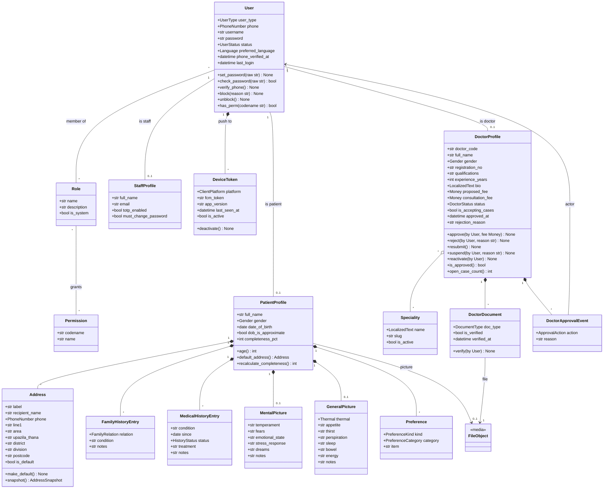
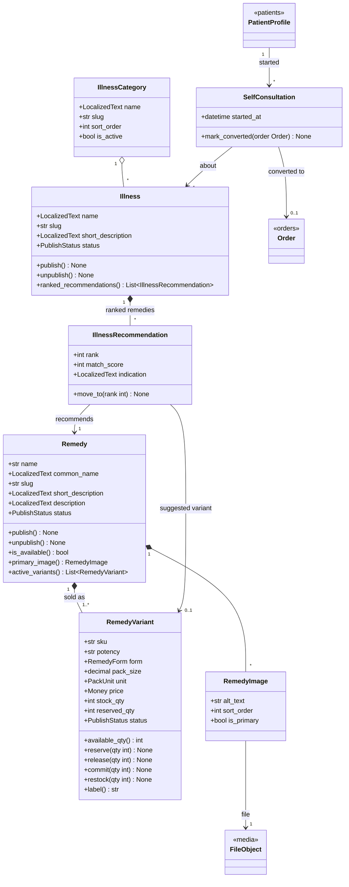
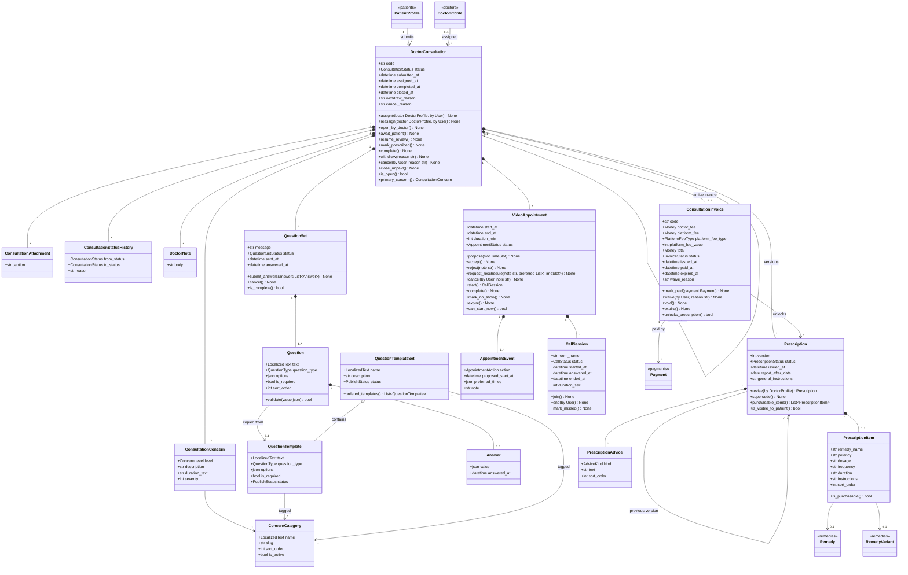
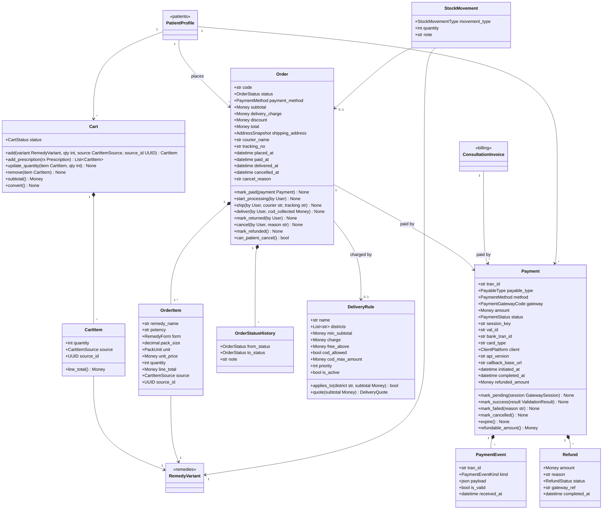
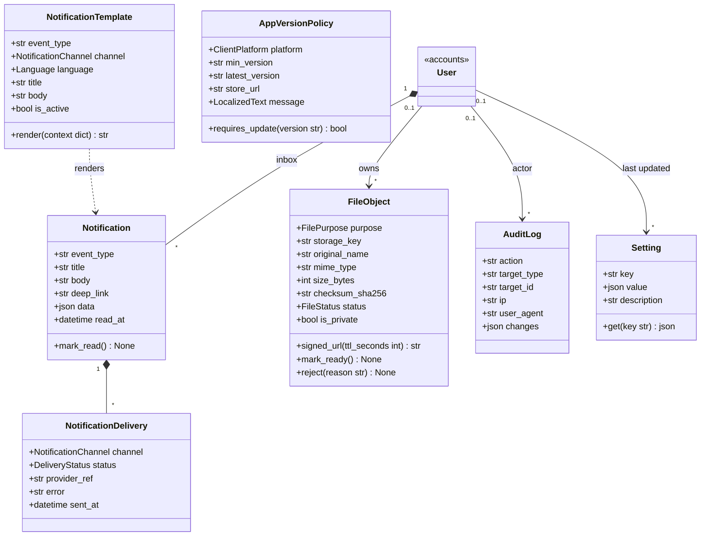
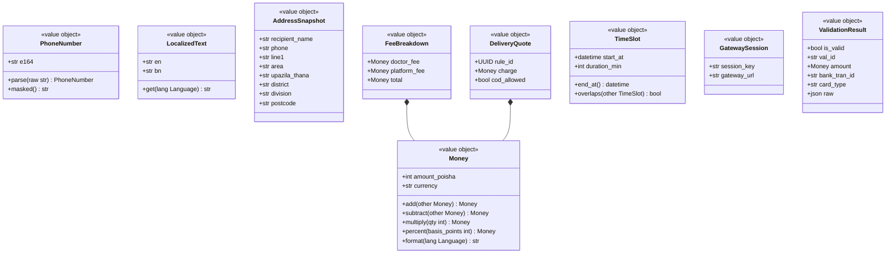

# HomeoHub — Class Diagram

> Version 0.1 · 2026-11-11 · Status: Draft for review
> Built from [04-domain-objects.md](04-domain-objects.md). Column types, nullability and constraints are in [06-data-dictionary.md](06-data-dictionary.md); tables and keys in [07-er-diagram.md](07-er-diagram.md).

## How to read this

- One diagram per area. A class shown with only a stereotype such as `<<patients>>` lives in another module and is drawn in full in that module's diagram.
- `id`, `created_at` and `updated_at` exist on every entity and are left out.
- Types are domain types: `Money` (integer poisha + currency), `LocalizedText` (`_en` / `_bn` pair), `PhoneNumber`, enums from §8.
- **Django mapping:** each entity is a `models.Model` in the module's Django app. Methods on the model are small rules about its own state (e.g. `Order.ship()` checks the transition is allowed). Work that touches several objects (checkout, payment processing, assigning a doctor) lives in the service classes of §7.

| Arrow | Meaning |
|---|---|
| `*--` | Composition — the part cannot exist without the whole (deleted with it) |
| `o--` | Aggregation — the part is linked but lives on its own |
| `-->` | Association — one object refers to another |
| `..>` | Dependency — uses, does not store |
| `..\|>` | Implements an interface |

---

## 1. accounts, patients, doctors

---

## 2. remedies, illnesses, self_consultation

---

## 3. doctor_consultancy, questionnaires, prescriptions, telemedicine, billing

---

## 4. cart, orders, payments

`Payment` belongs to **either** an `Order` **or** a `ConsultationInvoice`, never both (`payable_type` says which).

---

## 5. notifications, media, platform

---

## 6. Value objects

---

## 7. Services, interfaces and adapters

```mermaid
classDiagram
    class PaymentGateway {
        <<interface>>
        +initiate(payment Payment, urls CallbackUrls) GatewaySession
        +validate(val_id str) ValidationResult
        +parse_ipn(data dict) dict
        +refund(payment Payment, amount Money) str
    }
    class MockGateway
    class SSLCommerzGateway
    class SmsProvider {
        <<interface>>
        +send(to PhoneNumber, text str) str
    }
    class ConsoleSmsProvider
    class BdSmsProvider
    class PushProvider {
        <<interface>>
        +send(token str, title str, body str, data dict) str
    }
    class FcmPushProvider
    class VideoProvider {
        <<interface>>
        +create_room(name str) str
        +issue_token(room str, identity str, ttl int) str
        +close_room(name str) None
    }
    class LiveKitProvider
    class StorageProvider {
        <<interface>>
        +upload_url(key str, mime str) str
        +download_url(key str, ttl int) str
        +delete(key str) None
    }
    class S3StorageProvider
    class RemedyFinder {
        <<interface>>
        +find(description str, profile PatientProfile) List~FinderResult~
    }
    class DisabledRemedyFinder

    PaymentGateway <|.. MockGateway
    PaymentGateway <|.. SSLCommerzGateway
    SmsProvider <|.. ConsoleSmsProvider
    SmsProvider <|.. BdSmsProvider
    PushProvider <|.. FcmPushProvider
    VideoProvider <|.. LiveKitProvider
    StorageProvider <|.. S3StorageProvider
    RemedyFinder <|.. DisabledRemedyFinder

    class StateMachine {
        <<abstract>>
        +dict transitions
        +can(from_status str, to_status str) bool
        +transition(obj Model, to_status str, actor User, reason str) None
    }
    class ConsultationStateMachine
    class OrderStateMachine
    class PaymentStateMachine
    class AppointmentStateMachine
    class DoctorStateMachine
    class InvoiceStateMachine
    StateMachine <|-- ConsultationStateMachine
    StateMachine <|-- OrderStateMachine
    StateMachine <|-- PaymentStateMachine
    StateMachine <|-- AppointmentStateMachine
    StateMachine <|-- DoctorStateMachine
    StateMachine <|-- InvoiceStateMachine

    class AuthService {
        +signup_patient(data) User
        +signup_doctor(data) User
        +verify_otp(verification_id str, code str) TokenPair
        +login(identifier str, password str, user_type UserType) TokenPair
        +refresh(token str) TokenPair
        +reset_password(phone PhoneNumber, code str, new str) None
    }
    class DoctorConsultationService {
        +submit(patient PatientProfile, concerns list) DoctorConsultation
        +assign(consultation DoctorConsultation, doctor DoctorProfile, by User) None
        +withdraw(consultation DoctorConsultation, reason str) None
        +send_questions(consultation DoctorConsultation, questions list) QuestionSet
        +record_answers(question_set QuestionSet, answers list) None
    }
    class AppointmentService {
        +propose(consultation DoctorConsultation, slot TimeSlot) VideoAppointment
        +respond(appointment VideoAppointment, action AppointmentAction, note str) None
        +start_call(appointment VideoAppointment) CallSession
        +join_call(call CallSession, patient PatientProfile) str
    }
    class PrescriptionService {
        +issue(consultation DoctorConsultation, data dict) Prescription
        +revise(prescription Prescription, data dict) Prescription
        +view_for_patient(consultation DoctorConsultation) dict
    }
    class FeeCalculator {
        +calculate(doctor DoctorProfile) FeeBreakdown
    }
    class CheckoutService {
        +quote(cart Cart, address Address) DeliveryQuote
        +place_order(cart Cart, address Address, method PaymentMethod) Order
    }
    class DeliveryChargeCalculator {
        +quote(district str, subtotal Money) DeliveryQuote
    }
    class InventoryService {
        +reserve(order Order) None
        +release(order Order) None
        +commit(order Order) None
        +return_stock(order Order) None
    }
    class PaymentService {
        +start(payable Model, client ClientPlatform) GatewaySession
        +handle_ipn(data dict) Payment
        +reconcile_pending() int
        +record_cod(order Order, amount Money, by User) Payment
        +refund(payment Payment, amount Money, reason str) Refund
    }
    class NotificationService {
        +notify(user User, event_type str, context dict) Notification
    }
    class AuditService {
        +record(actor User, action str, target Model, changes dict) None
    }

    PaymentService ..> PaymentGateway
    PaymentService ..> PaymentStateMachine
    CheckoutService ..> DeliveryChargeCalculator
    CheckoutService ..> InventoryService
    PrescriptionService ..> FeeCalculator
    DoctorConsultationService ..> ConsultationStateMachine
    AppointmentService ..> VideoProvider
    AppointmentService ..> AppointmentStateMachine
    NotificationService ..> SmsProvider
    NotificationService ..> PushProvider
```

---

## 8. Enumerations

All enums are stored as upper-case text codes. The full list with every allowed value is in the data dictionary, [06-data-dictionary.md §17](06-data-dictionary.md#17-enumerations).
