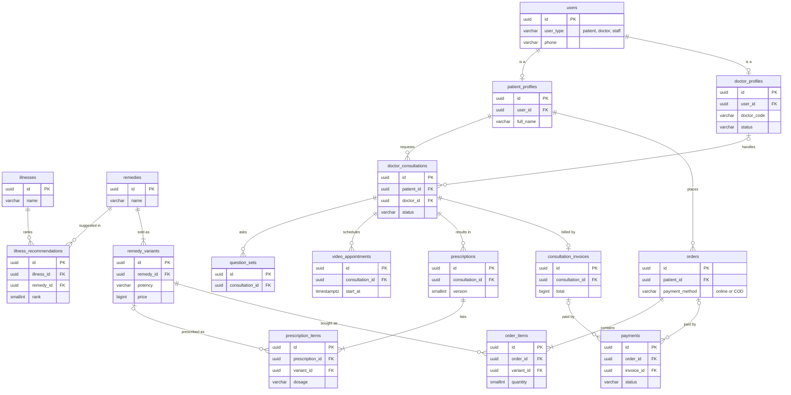
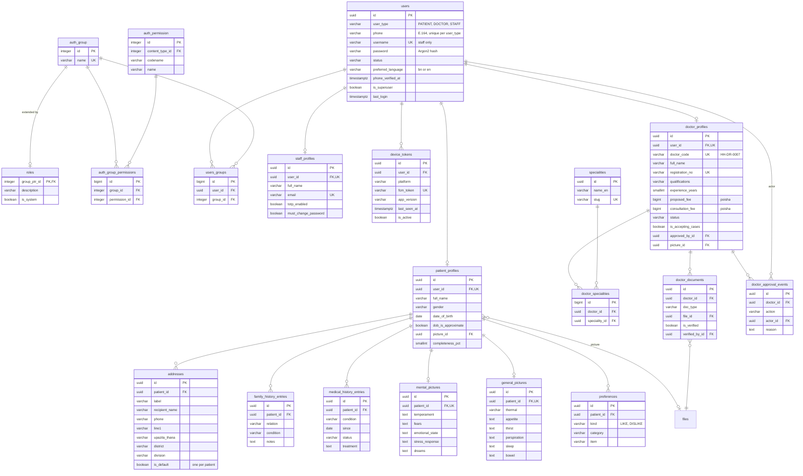
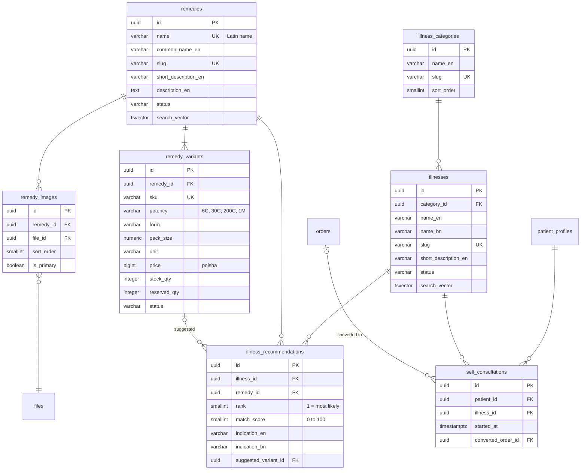
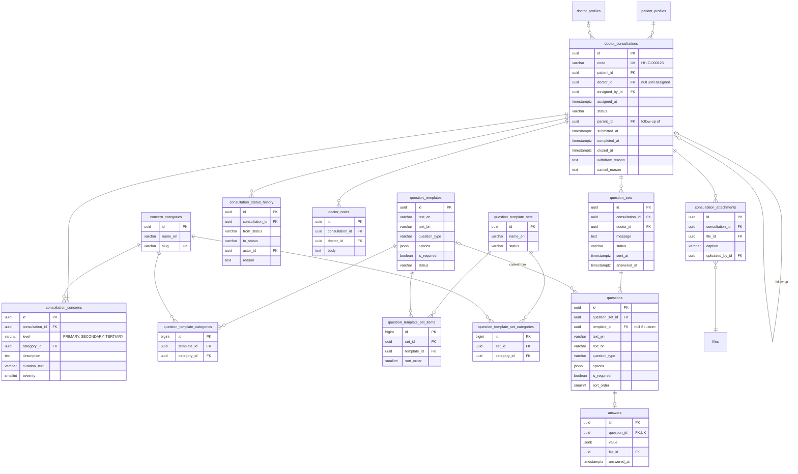
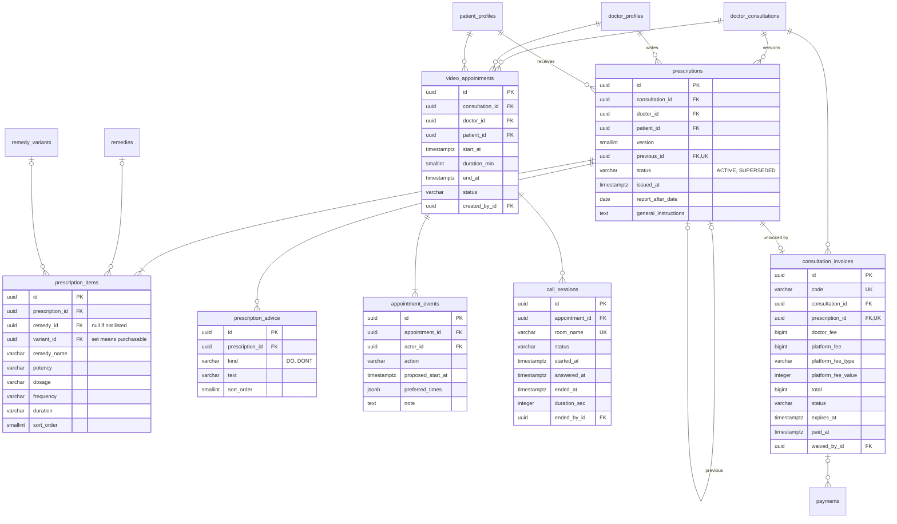
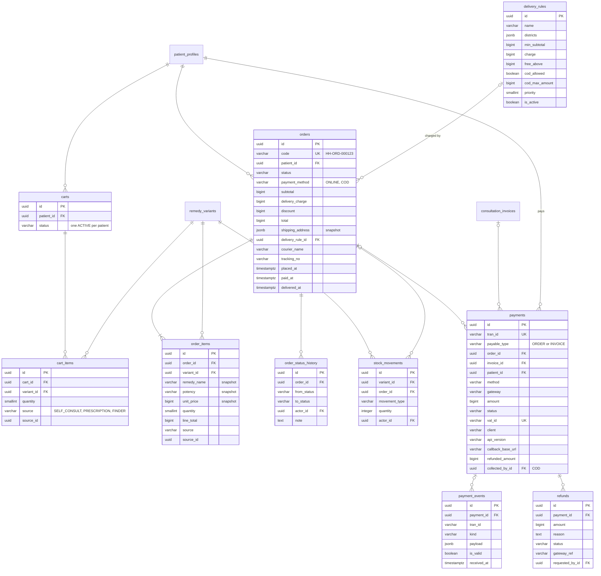
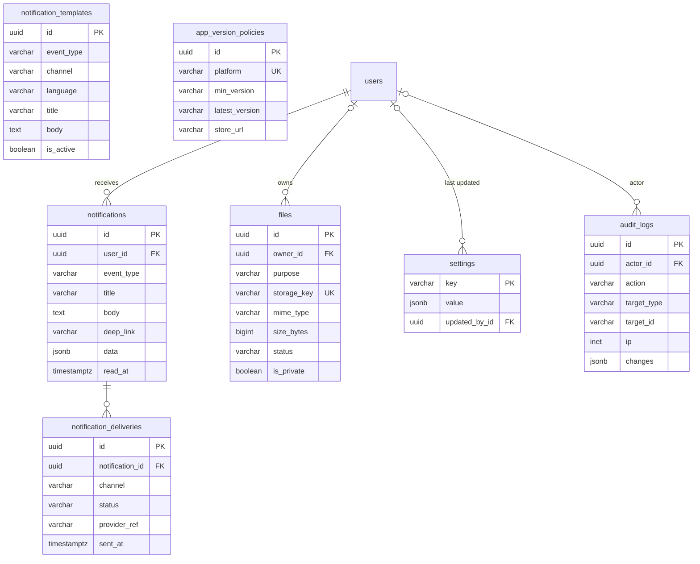

# HomeoHub — ER Diagram

> Version 0.1 · 2026-11-11 · Status: Draft for review
> Tables match [06-data-dictionary.md](06-data-dictionary.md) (full columns, types, defaults and constraints are there).

## How to read this

- §1 is the big picture: the main tables and how they connect, without columns.
- §2–§7 show each area with its keys and main columns. `created_at` / `updated_at` and most `_bn` translation columns are left out to keep the diagrams readable.
- A table shown without columns in an area diagram is drawn in full in another area.
- Crow's-foot notation:

| Symbol | Meaning |
|---|---|
| `\|\|` | exactly one |
| `o\|` / `\|o` | zero or one |
| `}o` / `o{` | zero or many |
| `}\|` / `\|{` | one or many |

---

## 1. Overview

The 16 core tables only. Supporting tables (history, events, templates, settings) are in §2–§7.

---

## 2. Accounts, patients and doctors

---

## 3. Remedies, illnesses and self-consultancy

---

## 4. Doctor-consultancy and questionnaires

---

## 5. Prescriptions, video appointments and billing

---

## 6. Cart, orders and payments

A payment row has **either** `order_id` **or** `invoice_id` (check constraint on `payable_type`).

---

## 7. Notifications, media and platform

`notification_templates` and `app_version_policies` stand alone: templates are matched by `event_type` + `channel` + `language`, not by a foreign key.
